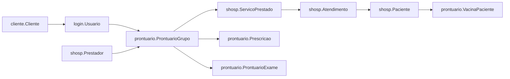
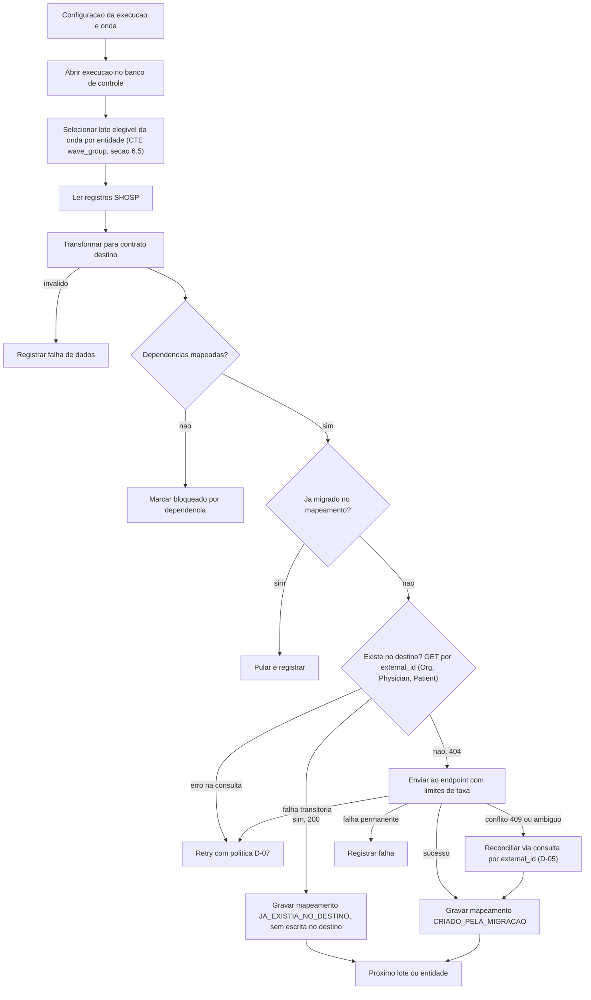

# PRD — Migração de dados do parceiro SHOSP para a Afya

Status: rascunho para revisão técnica. Data: 2026-10-26.

Convenção de marcação usada em todo o documento:

- **[FATO]**: confirmado no código ou na documentação (com referência).
- **[REQ]**: requisito definido pelo briefing ou pelo responsável do produto.
- **[HIP]**: hipótese a validar.
- **[QA]**: questão em aberto.
- **[REC]**: recomendação técnica, ainda não aprovada.

Caminhos abreviados: `MR` = `afya-prescription-monorepo/apps/prescription-backend/app`, `MZ` = `maagizo/backend`, `DM` = `DOCS-MAAGIZO`.

---

## 0. Documentos relacionados

Este é o PRD principal. Os PRDs abaixo detalham cada parte e remetem aos requisitos daqui (RF, RN, RNF e CA):

| PRD | Escopo |
| --- | --- |
| [PRD-01 — Organization](./PRD-01-organization.md) | consulta e criação de Organization na superfície de parceiro do monorepo |
| [PRD-02 — Physician](./PRD-02-physician.md) | consulta e criação de Physician na superfície de parceiro do monorepo |
| [PRD-03 — Patient](./PRD-03-patient.md) | consulta e criação de Patient na superfície de parceiro do monorepo |
| [PRD-04 — Prescription](./PRD-04-prescription.md) | endpoint novo no Maagizo para gravar e consultar as prescrições migradas |
| [PRD-05 — Aplicação Python](./PRD-05-aplicacao-python.md) | aplicação de migração: clientes de cada endpoint, transformação, orquestração, banco de controle e CLI |

---

## 1. Resumo executivo

Será construída uma aplicação local em Python que lê a base do parceiro SHOSP e transforma os registros de Organization, Physician, Patient e Prescription para os contratos da Afya. Ela envia esses registros, em lotes, para endpoints de persistência e mantém um banco local de controle com mapeamento de IDs, tentativas e falhas.

- Organization, Physician e Patient reutilizam endpoints existentes da superfície de parceiro do monorepo (`prescription-backend`), tanto para consulta quanto para criação [REQ]. Antes de criar, a aplicação consulta o destino pelo `external_id`. Se o registro já existe, nada é gravado no destino e só o mapeamento local é registrado.
- Prescription usa um endpoint novo, **implementado no Maagizo** [REQ], que não aciona SNCR nem Numerations.
- Cada prescrição SHOSP vira **uma única linha pai** em `prescription`, sem folha filha, com `apart = false` e `empty = false` [REQ].
- Cada item de origem vira um medicamento `type = "freeText"` em `immutable_data.items`, com `printType = "simple"` e `apart = false`, qualquer que seja o formato na base SHOSP [REQ].
- `freeTexts` fica `[]`, a não ser para anotações soltas do parceiro [REQ].
- As prescrições importadas **precisam poder ser renovadas**, por isso `imported_data_id` fica nulo [REQ].
- Receitas controladas não fazem parte deste contexto. Se aparecerem na origem, são migradas como `simple` [REQ].
- A implementação não cria nenhum campo novo nas tabelas da Afya. A única marca de importação é o `external_id` [REQ].

A investigação mostrou que o monorepo (`prescription-backend`) e o Maagizo gravam no **mesmo PostgreSQL `maagizo`** [FATO: `afya-prescription-monorepo/apps/prescription-backend/README.md`, linhas 3 e 48-52]. Por isso, a prescrição gravada pelo Maagizo é lida pelo monorepo (histórico, PDF e renovação) sem nenhuma sincronização.

As tabelas e as queries de origem vêm do [Guia de migração - prescrição legada](https://afya-spm.atlassian.net/wiki/spaces/Tech/pages/1552482315/Guia+de+migra+o+-+prescri+o+legada) (Confluence, versão 3, de 23/10/2026), detalhadas na seção 6.5. Colunas que o guia não documenta continuam como [HIP] ou [QA] até a validação na base real.

A migração acontece em **quatro ondas** [REQ] (seção 4.1): legado inativos, legado ativos, Memed inativos e Memed ativos. A carga inicial cobre só os clientes SHOSP inativos com data de inativação, com seus médicos, pacientes e prescrições legadas.

## 2. Contexto e problema

- [REQ] Migrar dados do SHOSP para a estrutura atual da Afya, de forma controlada, particionada, rastreável e reexecutável.
- [FATO] O SHOSP já é um parceiro conhecido:
  - no frontend do Maagizo, `PrescriptionPartnerId.SHOSP = '5b73f686-876b-4b81-b575-5a2df115fefd'` (`maagizo/frontend/digital-prescription-engine/src/shared/constants.ts`, linha 167);
  - como canal em `receitapro-frontend/apps/web/src/modules/menu/config/channels.ts`.
- [QA] Não há confirmação de que exista uma linha correspondente na tabela `partner` e um client Keycloak para o SHOSP em cada ambiente.
- [FATO] Precedente de migração em lote: a migração Memed no Maagizo, com `POST /v1/importer/migrationmemed`, workers importer e converter e a tabela `imported_data` (`DM/06-Workers/Memed-Importer-e-Converter.md` e `DM/10-Regras-de-Negocio/Migracoes.md`).

## 3. Objetivos e resultados esperados

- **O-01:** cada entidade elegível do SHOSP fica persistida uma única vez no destino, com relacionamentos reconstruídos.
- **O-02:** para cada registro de origem, é possível saber o estado, o ID de destino, o histórico de tentativas e o motivo de cada falha.
- **O-03:** a execução pode ser interrompida, retomada e reprocessada sem duplicar dados.
- **O-04:** nenhuma Prescription migrada consome numeração SNCR nem dispara o fluxo SNCR.
- **O-05:** toda Prescription migrada pode ser renovada e aparece corretamente no PDF, no resumo do histórico e na busca por título.
- **O-06:** a carga sobre a base SHOSP e sobre os serviços Afya é controlada por parâmetros configuráveis.

## 4. Escopo e fora de escopo

**Escopo:**

- Aplicação local de migração, com leitura direta da base SHOSP e transformação dos dados.
- Reutilização dos endpoints existentes de Organization, Physician e Patient, com consulta prévia por `external_id`.
- Endpoint novo e específico para Prescription.
- Banco local de controle e mapeamento.
- Registro de falhas.
- Processamento em lotes.
- Retomada e reprocessamento controlados.
- Execução em quatro ondas, por status do cliente e origem dos itens (seção 4.1). As ondas Memed estão especificadas aqui, mas o desenvolvimento delas é feito em outra história.

**Fora do escopo inicial** (cada item vira questão aberta se for necessário):

- Interface gráfica ou dashboard.
- Agendamento automático.
- Migração contínua ou sincronização incremental.
- Execução hospedada (a aplicação roda localmente). [QA] A partir de qual rede e contra quais ambientes.
- Migração de entidades não listadas: protocolos e modelos (`modelo."ModeloPrescricao"`, query 2.4 do guia), templates, LME e SADT como entidades próprias, arquivos PDF e assinaturas digitais.
- Itens com `codigoAfyaRx` preenchido, que já nasceram na Afya (RN-21).
- Atualização de registros que já existem no destino e relatório de divergências de dados.
- Escrita na base SHOSP.
- Notificação de parceiros via webhook.

### 4.1 Ondas de migração [REQ]

A migração é faseada. Cada execução da aplicação pertence a uma única onda, e as ondas rodam nesta ordem:

| Onda | Clientes (`cliente."Cliente"`) | Itens de prescrição |
| --- | --- | --- |
| 1. Legado inativos | inativos, com data de inativação | legados: `Prescricao` com `codigoAfyaRx` e `codigoMemed` nulos, `ProntuarioExame` e `VacinaPaciente` com `codigoAfyaRx` nulo |
| 2. Legado ativos | ativos | legados, com o mesmo filtro da onda 1 |
| 3. Memed inativos | inativos, com data de inativação | `Prescricao` com `codigoMemed` preenchido |
| 4. Memed ativos | ativos | `Prescricao` com `codigoMemed` preenchido |

- **Carga inicial (onda 1):** só os clientes inativos com data de inativação, os médicos desses clientes, os pacientes desses clientes e as prescrições legadas deles [REQ]. Um médico ou paciente só entra na onda se tiver pelo menos um grupo de prontuário elegível num cliente da onda (CTE `wave_group`, seção 6.5).
- **Critério de status do cliente** [QA]: o guia não documenta as colunas de status nem de data de inativação. A proposta [HIP] é:
  - inativo: `c.ativo = false and c."dataInativacao" is not null`;
  - ativo: `c.ativo = true`.
- **Cliente inativo sem data de inativação:** não entra em nenhuma onda e aparece no relatório como "status indefinido" (CA-25). [QA] O que fazer com esses clientes.
- **Mudança de status entre ondas:** o status é avaliado no início de cada execução (RN-22). [REC] Um cliente que ficou inativo depois da onda 1 não entra na onda 2; ele é migrado numa repescagem da onda 1. [QA] Confirmar com o produto.
- **Entidades compartilhadas entre ondas:** Organization, Physician e Patient já `MIGRADO` numa onda anterior são reaproveitados pelo mapeamento local, sem nova chamada ao destino (RN-06).
- **Grupo com itens legados e Memed:** gera duas prescrições, uma na onda legada e outra na onda Memed, com `external_id` distintos (RN-21 e RN-23).
- **Volume:** é medido por onda com as queries de contagem da seção 6.5.4, antes de cada carga.
- **Estratégia das ondas Memed:** depende de D-11 (conteúdo dos itens Memed na SHOSP).

## 5. Glossário e conceitos relevantes

- **Parceiro (`partner`)**: tenant de integração, dono das organizações (`DM/03-Entidades/Parceiro.md`).
- **`external_id`**: chave do parceiro na Afya [FATO: `MZ/pkg/postgres/migrations/20210810135000_initial_model.up.sql`, linhas 128-140]:
  - Organization é única por `(partner_id, external_id)`;
  - Physician e Patient são únicos por `(org_id, external_id)`.
- **`immutable_data`**: JSONB obrigatório que guarda itens, exames e vacinas da prescrição. Não existe tabela normalizada de itens [FATO: `MZ/pkg/postgres/prescription_storage.go`, linhas 48-55].
- **Item `freeText`**: item de medicamento em `immutable_data.items[]`, com `type = "freeText"` e corpo `freeText` (`title` com até 40000 caracteres, `patientInstruction`, `unit` e `quantity`). No PDF, imprime título, posologia, quantidade e unidade [FATO: `MR/prescription/entrypoint/rest/schemas.py`, linhas 229-240 e 347-361; `MZ/pkg/prescription/item_free_text.go`].
- **`freeTexts`**: lista de topo `[]string` (`MZ/pkg/prescription/prescription.go`, linha 42) para **anotações soltas** (por exemplo, "Retorno em 30 dias."). Não é lugar de item prescrito. Se um medicamento for parar ali:
  - o `print_type` da folha vira `freeText` e ela passa na frente do receituário;
  - o PDF imprime só o título, sem posologia, quantidade ou unidade;
  - o `items_qty` deixa de contar o item como medicamento;
  - a busca no histórico passa a ler `$.freeTexts[*]` em vez de `$.items[*].*.title`.
- **`apart`**: flag do item (`items[].apart`) e coluna da linha. `true` no item significa que ele sai da pai e imprime numa folha filha. O PDF e o resumo do histórico ignoram, na pai, os itens com `apart = true`.
- **Renovação**: recarregar uma prescrição no carrinho. É decidida por `is_renewable` (`MR/prescription/service/build_prescription_renewal_service.py`, linhas 169-206).
- **SNCR**: fluxo de receituário controlado. No create, aloca numeração FIFO do schema `numeration`. A chamada à Anvisa só acontece nos endpoints `/v1/sncr-numerations/*`.
- **Numerations**: schema `numeration` (tabelas `available_numeration`, `used_numeration`, `prescriber` etc.), que pertence ao `prescription-backend`.
- **Banco de controle**: base local da aplicação de migração. Não é a fonte oficial de dados.
- **Onda**: recorte de uma execução por status do cliente (inativo ou ativo) e origem dos itens (legado ou Memed). Ver seção 4.1.
- **Grupo do prontuário (`prontuario."ProntuarioGrupo"`)**: agrupador dos itens prescritos num atendimento SHOSP. Cada grupo vira uma prescrição na Afya (RF-06a).
- **Item legado**: item criado no prontuário da SHOSP, sem integração Memed nem AfyaRx (filtro da seção 6.5.2).
- **Execução** e **tentativa**: ver seção 11.

## 6. Arquitetura e sistemas envolvidos

- [FATO] **prescription-backend** (FastAPI, Python 3.13, SQLAlchemy async): grava Organization, Physician, Patient e Prescription diretamente no PostgreSQL `maagizo`. O Alembic só controla os schemas próprios (`numeration`) (`afya-prescription-monorepo/apps/prescription-backend/README.md` e `CLAUDE.md`, seção "Banco compartilhado maagizo").
- [FATO] **prescription-bff**: sem banco, só orquestra. Não é adequado para carga em lote (`afya-prescription-monorepo/apps/prescription-bff/CLAUDE.md`).
- [FATO] **Maagizo (Go/Echo)**: dono do DDL do schema `public` e das rotas legadas v1 e v2. A criação de prescrição pode ser enviada por proxy ao backend pela flag `afyarx-api.prescription-creation.sncr-prescription-type` (`MZ/pkg/http/restecho/routes/physician/post_prescriptions_sncr.go`, linhas 13-15).
- [FATO] A direção documentada é um *strangler* incremental: novas rotas de escrita em Python, sobre o banco compartilhado (`docs-migracao/PLANO-execucao-modelos-prescricao.md` e `docs-migracao/PROMPT-migracao-modelos-prescricao.md`).

### 6.1 Famílias de endpoints existentes para Organization, Physician e Patient

As consultas e a criação usam a família 1 [REQ] (D-09 e D-09b). O detalhamento por entidade está nos PRDs [01](./PRD-01-organization.md), [02](./PRD-02-physician.md) e [03](./PRD-03-patient.md).

[FATO] Os `GET` e `POST` da família 1 **não devolvem o ID interno** (UUID) da entidade, só o `external_id` (`MR/organization/entrypoint/rest/partner_organization_schemas.py`, linhas 24-42; `MR/physician/entrypoint/rest/partner_physician_schemas.py`, linhas 116-134; `MR/patient/entrypoint/rest/partner_schemas.py`, linhas 94-121). Por isso, o mapeamento local usa o `external_id` como chave de destino (RF-07), e o endpoint de Prescription recebe external IDs e resolve os IDs internos no Maagizo (PRD-04).

[FATO] O `POST` de Physician da família 1 também faz find-or-create de um usuário no PrescriptionAuth (Keycloak) pelo e-mail do médico (`MR/physician/service/link_partner_physician_auth_service.py`). Ver PRD-02, seção 2.3.

1. **prescription-backend, superfície de parceiro.** Autenticação por `PartnerToken` (Keycloak RS256/JWKS, papel `passwordless`, em `MR/common/dependencies/partner_auth.py`). Prefixo `/v1/partner/organizations`. Pelos PRDs de webhook, essas rotas **não emitem webhooks** (`docs-webhook-prescricao/07 - Integrações/Superfície de Injeção do Parceiro.md`).
   - Organization:
     - `POST /v1/partner/organizations` responde 201, ou 409 se o `external_id` já existir (`MR/organization/entrypoint/rest/partner_organization_router.py`, linhas 49-82);
     - `GET /{org_external_id}` (linha 85) e `PATCH /{org_external_id}` (linha 116).
   - Physician:
     - `POST /{org_external_id}/physicians` responde 409 com `PhysicianExternalIdAlreadyExistsException` (`MR/physician/usecases/create_partner_physician_usecase.py`, linhas 32-46);
     - `GET /{org_external_id}/physicians/{physician_external_id}` (`MR/physician/entrypoint/rest/partner_physician_router.py`, linha 135).
   - Patient:
     - `POST /{org_external_id}/patients` responde 409 se o `external_id` já existir na organização (`MR/patient/entrypoint/rest/partner_patient_router.py`, linha 73);
     - `GET /{org_external_id}/patients/{external_id}` responde 404 para paciente inexistente **ou removido logicamente** (linhas 150-162).
2. **prescription-backend, rotas internas** (`/v1/orgs`, `/v1/orgs/{org}/physicians` e `/v1/physicians/{id}/patients`): sem autenticação na aplicação, contando com isolamento de rede. As rotas de paciente emitem `patient.created` (`PRDS-WEBHOOK/PRD-15-16 - Eventos de paciente.md`).
3. **Maagizo v1 de parceiro**, com header `api-key`:
   - Organization: `POST` e `PUT /v1/partner/orgs`. O `PUT` faz upsert com `ON CONFLICT (partner_id, external_id)` (`MZ/pkg/postgres/org_storage.go`, linha 54).
   - Physician: `PUT /v1/partner/orgs/physicians`, com upsert.
   - Patient: só pela rota `PUT /v1/physician/patients`, que exige JWT de médico e faz upsert por `externalId`.
4. **Maagizo v2**: sem autenticação na aplicação (`MZ/pkg/http/restecho/routes/router/version2/router.go`, linhas 20-23). [FATO] O `PUT` de physician sobrescreve o `externalId` com o external ID da organização (`MZ/pkg/http/restecho/routes/partner/put_org_physicians_v2.go`, linhas 41-43). Não é adequado sem correção.

### 6.2 Prescription hoje

- [FATO] Criação pelo backend: `POST /v1/physicians/{id}/prescriptions`, com o use case `create_prescription_usecase`. Etapas:
  - resolução de organização, paciente e médico;
  - validação;
  - agrupamento de itens;
  - alocação SNCR (`_create_prescription_with_sncr_numeration`, a partir da linha 374);
  - LME e SADT;
  - outbox `prescription.created` (`_enqueue_prescription_created_events`, a partir da linha 483);
  - após o commit: publicação de webhook, sinks (labels, instruções e interações), PDF e relatório LME (`MR/prescription/entrypoint/rest/prescription_router.py`, linhas 101-116).
- [FATO] O precedente Memed persiste direto via `PrescriptionSvc.Save`, com `external_id` e `imported_data_id`, sem SNCR, PDF nem webhooks. A deduplicação é feita na aplicação, com `AlreadyImported` (`MZ/pkg/memed/workers/converter_data_worker.go`, linhas 470-493).
- **Esse precedente não deve ser copiado à risca:** `imported_data_id` preenchido gera `RenewalBlocker.IMPORTED_PRESCRIPTION` e bloqueia a renovação, qualquer que seja o tipo do item (`build_prescription_renewal_service.py`, linhas 188-189).

### 6.3 Endpoint de Prescription no Maagizo [REQ]

O endpoint novo de Prescription será implementado no Maagizo. O contrato proposto, a idempotência, a gravação dedicada e os critérios de aceite estão no [PRD-04 — Prescription](./PRD-04-prescription.md). O código de apoio que já existe lá tem efeitos que o endpoint precisa evitar:

- [FATO] `PrescriptionService.Save` (`MZ/pkg/services/prescription_svc.go`, linhas 287-307):
  - chama `SetEmpty()` antes de gravar;
  - dispara, em goroutines, `updatePatientInstructions` (que ignora itens `freeText`, linhas 222-224) e `insertPrescriptionLabel`;
  - envia contagem ao SenseData quando `ExternalID` é vazio. Com `external_id` preenchido, o envio não acontece.
- [FATO] `storage.Save` grava o paciente na mesma transação (`patientStorage.fill`, em `MZ/pkg/postgres/prescription_storage.go`, a partir da linha 569). Isso pode alterar um paciente que já existia, o que contraria RN-07a.
- [FATO] O caminho legado `POST /v1/physician/prescriptions` também gera filhos `apart` e futuros, LME e SADT, publica no event stream e grava interações (`MZ/pkg/http/restecho/routes/physician/post_prescriptions.go`, linhas 175-265). Nada disso pode acontecer no endpoint novo.
- [FATO] O Maagizo não grava na `partner_webhook_outbox`. As gravações nessa tabela ficam no `prescription-backend` (`docs-webhook-prescricao/02 - Arquitetura/Maagizo.md`).
- [FATO] O grupo `/v1/partner` usa autenticação por `api-key` (`MZ/pkg/http/restecho/handler.go`, linhas 117-119) e já tem uma rota de prescrição de parceiro (`PUT /v1/partner/iclinic/prescriptions`).
- Ficam para o planejamento técnico ([QA]):
  - rota, versão e contrato do endpoint novo;
  - grupo de autenticação. Recomendação [REC]: `/v1/partner` com `api-key`, com o `partner_id` vindo da chave e não do corpo, para não repetir a falha de escopo do importer (`handler.go`, linha 281);
  - se o endpoint reutiliza `PrescriptionService.Save` ou usa uma gravação dedicada sem upsert de paciente, sem labels e sem as demais goroutines.

### 6.4 Consultas e criação de Organization, Physician e Patient no monorepo [REQ]

A consulta prévia (RF-02a), a criação (RF-03 a RF-05) e a reconciliação (RF-18) usam os endpoints que já existem na superfície de parceiro do `prescription-backend` (seção 6.1, família 1). A família 1 foi escolhida em vez do Maagizo porque o Maagizo não tem `GET` de Organization, só tem `GET` de Physician e Patient no grupo v2 (sem autenticação na aplicação) e faz upsert nas criações. A aplicação local precisa de dois tipos de credencial: `PartnerToken` (Keycloak), para o monorepo, e a `api-key` do endpoint novo do Maagizo (PRD-05, seção 4).

### 6.5 Origem SHOSP

Fonte: [Guia de migração - prescrição legada](https://afya-spm.atlassian.net/wiki/spaces/Tech/pages/1552482315/Guia+de+migra+o+-+prescri+o+legada) [FATO: guia]. O SGBD da SHOSP é PostgreSQL [HIP forte: o guia usa schemas e identificadores entre aspas duplas]. As queries abaixo são propostas e precisam ser validadas na base real antes do desenvolvimento.

#### 6.5.1 Tabelas e entidades de destino

| Tabela SHOSP | Entidade Afya | Colunas usadas (dicionário do guia) | PRD |
| --- | --- | --- | --- |
| `cliente."Cliente"` | Organization | `prk`, `nome`, `email`, `telefone1`, `celular`; status e data de inativação [HIP] | [PRD-01](./PRD-01-organization.md) |
| `shosp."Prestador"` | Physician | `prk`, `nome`, `razaoSocial`, `cpf`, `cnpj`, `cns`, `email`, `sexo`, `dataNascimento` | [PRD-02](./PRD-02-physician.md) |
| `shosp."Paciente"`, `shosp."Cidade"`, `shosp."Estado"` | Patient | `prk`, `nome`, `apelido`, `nomeMae`, `cpf`, `dataNascimento`, `sexo`, `email`, `celular`, `telefone`, endereço, `c.nome`, `e.uf` | [PRD-03](./PRD-03-patient.md) |
| `prontuario."ProntuarioGrupo"` | Prescription (linha pai) | `prk`, `frkUsuario`, `frkPrestador`, `frkServicoPrestado` | [PRD-04](./PRD-04-prescription.md) |
| `prontuario."Prescricao"` | item `freeText` | `prk`, `frkProntuarioGrupo`, `item`, `quantidade`, `nrQuantidade`, `forma`, `dosagem`, `via`, `frequencia`, `duracao`, `observacao`, `folha`, `codigoMemed`, `codigoAfyaRx` | PRD-04 |
| `prontuario."ProntuarioExame"` | item `freeText` | `prk`, `frkProntuarioGrupo`, `nomeProcedimento`, `orientacaoProcedimento`, `qtd`, `ativo`, `nrFolha`, `codigoAfyaRx` | PRD-04 |
| `prontuario."VacinaPaciente"` | item `freeText` | `frkPaciente`, `descricao`, `status`, `dataSolicitacao`, `dataVacina`, `lote`, `local`, `codigoAfyaRx` | PRD-04 |
| `login."Usuario"` | (ligação) | `prk`, `nome`, `frkCliente` | — |
| `shosp."ServicoPrestado"`, `shosp."Atendimento"` | (ligação) | `prk`, `frkAtendimento`, `frkPaciente` | — |

Cadeia de ligação:



- A organização de um grupo é o cliente do usuário que o registrou: `ProntuarioGrupo.frkUsuario` → `login."Usuario".frkCliente`.
- O médico é `ProntuarioGrupo.frkPrestador`.
- O paciente é `ProntuarioGrupo.frkServicoPrestado` → `ServicoPrestado.frkAtendimento` → `Atendimento.frkPaciente`.
- [QA] O guia liga `VacinaPaciente` só ao paciente (`frkPaciente`), sem grupo nem prestador. Ver PRD-04, seção 10.3.

#### 6.5.2 Filtros de origem [FATO: guia]

- **Item legado em `Prescricao`:** `codigoAfyaRx is null and codigoMemed is null`. A coluna `codigoReceitaPro` não é considerada [REQ].
- **Item legado em `ProntuarioExame`:** `codigoAfyaRx is null and ativo`.
- **Item legado em `VacinaPaciente`:** `codigoAfyaRx is null`.
- **Item Memed:** `Prescricao` com `codigoMemed is not null`.
- **Item AfyaRx:** `codigoAfyaRx is not null`. Nunca é migrado (RN-21).

#### 6.5.3 CTE base, parametrizada por onda

Todas as queries de leitura dos PRDs 01 a 04 partem desta CTE. `:wave_status` vale `inativo` ou `ativo`, e `:wave_origin` vale `legado` ou `memed`.

```sql
with wave_cliente as (
  select c.prk
  from cliente."Cliente" c
  where (:wave_status = 'inativo' and c.ativo = false and c."dataInativacao" is not null) -- [HIP] nomes das colunas
     or (:wave_status = 'ativo'   and c.ativo = true)
),
wave_group as (
  select pg.prk           as grupo_id,
         u."frkCliente"   as cliente_id,
         pg."frkPrestador" as prestador_id,
         a."frkPaciente"  as paciente_id
  from prontuario."ProntuarioGrupo" pg
  join login."Usuario" u          on u.prk = pg."frkUsuario"
  join wave_cliente wc            on wc.prk = u."frkCliente"
  join shosp."ServicoPrestado" sp on sp.prk = pg."frkServicoPrestado"
  join shosp."Atendimento" a      on a.prk = sp."frkAtendimento"
  where (:wave_origin = 'legado' and (
          exists (select 1 from prontuario."Prescricao" p
                  where p."frkProntuarioGrupo" = pg.prk
                    and p."codigoAfyaRx" is null and p."codigoMemed" is null)
       or exists (select 1 from prontuario."ProntuarioExame" pe
                  where pe."frkProntuarioGrupo" = pg.prk
                    and pe."codigoAfyaRx" is null and pe.ativo)))
     or (:wave_origin = 'memed' and
          exists (select 1 from prontuario."Prescricao" p
                  where p."frkProntuarioGrupo" = pg.prk
                    and p."codigoMemed" is not null))
)
```

As organizações, os médicos, os pacientes e as prescrições elegíveis de uma onda são só os que aparecem em `wave_group`. A paginação é keyset por `prk` (RF-APP-08).

#### 6.5.4 Queries de contagem por onda

Adaptadas das queries 3.1, 3.2 e 2.3 do guia, com a CTE da seção 6.5.3. Servem para dimensionar cada onda antes da carga (seção 17).

```sql
-- contas, usuarios, medicos, pacientes e grupos elegiveis da onda
select count(distinct cliente_id)   as total_contas,
       count(distinct prestador_id) as total_medicos,
       count(distinct paciente_id)  as total_pacientes,
       count(distinct grupo_id)     as total_prescricoes
from wave_group;

-- usuarios com prescricao legada (guia 3.2), restrito aos clientes da onda
select count(distinct u.prk) as total_usuarios_legado
from prontuario."Prescricao" p
join prontuario."ProntuarioGrupo" pg on pg.prk = p."frkProntuarioGrupo"
join login."Usuario" u on u.prk = pg."frkUsuario"
join wave_cliente wc on wc.prk = u."frkCliente"
where p."codigoAfyaRx" is null and p."codigoMemed" is null;

-- grupos com itens legados e Memed ao mesmo tempo (geram duas prescricoes, RN-21)
select count(*) as grupos_mistos
from prontuario."ProntuarioGrupo" pg
where exists (select 1 from prontuario."Prescricao" p
              where p."frkProntuarioGrupo" = pg.prk
                and p."codigoAfyaRx" is null and p."codigoMemed" is null)
  and exists (select 1 from prontuario."Prescricao" p
              where p."frkProntuarioGrupo" = pg.prk and p."codigoMemed" is not null);

-- clientes inativos sem data de inativacao (fora das ondas, CA-25)
select count(*) as clientes_status_indefinido
from cliente."Cliente" c
where c.ativo = false and c."dataInativacao" is null;
```

## 7. Fluxo geral de migração



Prescription não passa pela consulta prévia de Organization, Physician e Patient. A deduplicação dela segue RN-10.

Ordem de dependências [FATO: FKs]:

1. Organization.
2. Physician (FK `org_id`) e Patient (FK `org_id`, sem FK para médico). Os dois podem rodar em paralelo depois de Organization.
3. Prescription (FK para organização, médico e paciente).

## 8. Requisitos funcionais

- **RF-01 — Leitura da origem:** ler os registros elegíveis do SHOSP só com permissão de leitura, com paginação keyset por `prk` e filtrados pela onda da execução (seção 4.1). As tabelas, os filtros e a CTE base estão na seção 6.5. [QA] Validar na base real as colunas que o guia não documenta.
- **RF-02 — Transformação:** cada entidade tem uma transformação determinística da origem para o contrato de destino, separada do envio. A saída é validada contra as regras do destino antes da chamada. Exemplos:
  - CPF e passaporte do paciente;
  - UF e conselho do médico, e o e-mail obrigatório dele;
  - `cnes` com até 7 caracteres e `external_id` com até 36.
- **RF-02a — Consulta prévia no destino (Organization, Physician e Patient):** antes de qualquer chamada de criação, a aplicação consulta o destino pelo `external_id`, no escopo do parceiro SHOSP (Organization) ou da organização já mapeada (Physician e Patient) [REQ]. Não se usa chave natural, como CNES, CPF ou CRM [REQ].
  - **Encontrado (200):** a aplicação não escreve nada no destino, nem POST nem PATCH. Os dados não são comparados. Ela só grava o mapeamento local com o ID encontrado, o estado `MIGRADO` e a origem `JA_EXISTIA_NO_DESTINO` [REQ].
  - **Não encontrado (404):** segue para a criação (RF-03 a RF-05).
  - **Erro na consulta** (timeout, 5xx, 401 ou 403): é tratado pela política de falhas da seção 13. Nunca segue para a criação sem uma resposta conclusiva.
  - As consultas usam os endpoints que já existem no monorepo, na superfície de parceiro do `prescription-backend` [REQ]:
    - `GET /v1/partner/organizations/{org_external_id}`;
    - `GET /v1/partner/organizations/{org_external_id}/physicians/{physician_external_id}`;
    - `GET /v1/partner/organizations/{org_external_id}/patients/{external_id}`.
  - [FATO] O `GET` de paciente responde 404 também para paciente removido logicamente. Nesse caso, o `POST` seguinte pode receber 409, por causa da unicidade `(org_id, external_id)`. [QA] Como tratar paciente removido logicamente que existe no destino: falha de dados ou mapeamento `JA_EXISTIA_NO_DESTINO`?
- **RF-03 — Organization:** migrar pelo `POST /v1/partner/organizations` (D-09b), com `external_id` derivado do ID SHOSP e sob o `partner_id` do SHOSP. Detalhes no PRD-01.
- **RF-04 — Physician:** migrar no escopo da organização já mapeada, com `external_id` único por organização. A organização do médico vem do grupo do prontuário (`frkPrestador` e o cliente do usuário, seção 6.5.1), então o mesmo `Prestador` pode aparecer em mais de um `Cliente`. Há um registro por par (prestador, cliente) [REC].
- **RF-05 — Patient:** migrar no escopo da organização. O destino não vincula paciente a médico [FATO]. Documento ausente ou estrangeiro é tratado com os campos `hasNoCpf`, `isForeignPatient` e `passport`.
- **RF-06 — Prescription:** persistir pelo endpoint novo e dedicado, implementado no Maagizo [REQ] (seção 6.3). Ele não grava nem atualiza paciente, médico ou organização; só referencia os IDs já mapeados. Ele grava `prescription` com `immutable_data`, `external_id`, `prescription_date` e `signed`. Ele **não executa**:
  - alocação SNCR, `used_numeration` nem chamadas à API SNCR;
  - outbox de webhook;
  - geração de PDF;
  - SenseData;
  - LME e SADT;
  - event stream, interações e labels do Maagizo;
  - upsert de paciente.
- **RF-06a — Uma linha pai, sem filha:** cada prescrição SHOSP, isto é, cada `prontuario."ProntuarioGrupo"` elegível na onda [REQ], gera exatamente uma linha em `prescription`, com:
  - `parent_id` nulo;
  - coluna `apart = false`;
  - coluna `empty = false`;
  - `imported_data_id` nulo.

  Não são gerados filhos `apart`, futuros, LME nem SADT [REQ].
- **RF-06b — Cada item como medicamento `freeText`:** cada item prescrito na SHOSP (medicamento, exame, vacina, orientação ou outro) vira **um** elemento de `immutable_data.items`, qualquer que seja o formato na origem [REQ]. Cada elemento tem:
  - `type = "freeText"`, `printType = "simple"`, `apart = false` e `withinLme = false`;
  - `freeText.title`: texto do item;
  - `freeText.patientInstruction`: posologia ou instrução;
  - `freeText.unit` e `freeText.quantity`: quando existirem na origem. Quando não existirem, `""` e o valor padrão a definir ([QA]).

  Fontes dos itens [REQ]:
  - ondas legadas: `prontuario."Prescricao"` (legados), `prontuario."ProntuarioExame"` e `prontuario."VacinaPaciente"`;
  - ondas Memed: `prontuario."Prescricao"` com `codigoMemed` preenchido (D-11).

  O de-para campo a campo de cada fonte está no PRD-04, seção 10.5 ([REC], a validar com amostras reais). Nenhum item é enriquecido com catálogo (produto ou substância), EAN ou campos `sncr_*`.
- **RF-06c — Listas de topo:** `exams = []`, `vaccines = []`, sem `lme` e `freeTexts = []`. O único uso de `freeTexts` é para um texto da SHOSP que já era anotação solta, e não item prescrito. [QA] Esse campo existe na origem? Como identificá-lo?
- **RF-06d — Formato de referência:** o `immutable_data` repete o formato que o fluxo normal produz quando há só itens `freeText` simples, sem exames, vacinas nem `freeTexts`:

  ```json
  {
    "items": [
      {
        "type": "freeText",
        "printType": "simple",
        "apart": false,
        "withinLme": false,
        "freeText": {
          "title": "Amoxicilina 500 mg",
          "patientInstruction": "1 comprimido de 8 em 8 horas por 7 dias",
          "unit": "",
          "quantity": 21
        }
      }
    ],
    "exams": [],
    "vaccines": [],
    "freeTexts": []
  }
  ```

  [QA] Confirmar no planejamento técnico as demais chaves que o leitor legado espera no snapshot da pai (por exemplo, `patient`, `physician` e `organization`), comparando com uma prescrição real que tenha só itens `freeText`.
- **RF-06e — Ordem e fidelidade:** a ordem dos itens na origem é preservada. A transformação é determinística (mesma origem, mesmo texto) e não perde conteúdo. Um texto com mais de 40000 caracteres é falha de dados, sem truncamento.
- **RF-06f — Renovável:** toda prescrição migrada passa em `is_renewable`, exceto por motivos legítimos do destino, como paciente removido (`PATIENT_UNAVAILABLE`).
  - [FATO] Para itens `freeText`, a renovação não exige ID de catálogo nem `patientInstruction`.
  - [FATO] A renovação é bloqueada por `withinLme` ou `isLme` verdadeiros, por ausência de itens (`NO_ITEMS`) e por elemento de `freeTexts` que não seja string (`build_prescription_renewal_service.py`, linhas 122-144 e 188-206).
- **RF-07 — Mapeamento persistente:** para cada par (entidade, ID de origem) existe no máximo um mapeamento ativo para o destino. A chave de destino é o `external_id` enviado, porque os endpoints de parceiro do monorepo não expõem o ID interno (seção 6.1). O ID interno da Afya só é guardado quando o endpoint o devolve, o que hoje acontece apenas em Prescription (PRD-04).
- **RF-08 — Estados:** cada registro tem um estado atual (seção 11), e as transições ficam registradas.
- **RF-09 — Falhas:** cada falha registra:
  - tipo de entidade e ID de origem;
  - ID de destino, se houver;
  - etapa e categoria;
  - mensagem sanitizada;
  - execução e tentativa.
- **RF-10 — Lotes:** o processamento é feito por lotes de tamanho configurável, por entidade.
- **RF-11 — Retomada:** uma nova execução continua a partir do estado persistido, sem reprocessar sucessos.
- **RF-12 — Reprocessamento:** é possível selecionar registros com falha (por entidade, categoria ou execução) e reprocessá-los, preservando o histórico.
- **RF-13 — Idempotência:** reenviar um registro já persistido não cria duplicata no destino.
- **RF-14 — Dependências:** um registro cuja dependência não está mapeada não é enviado. Ele fica como bloqueado e volta a ser elegível quando a dependência for migrada.
- **RF-15 — Configuração:** são configuráveis:
  - conexões e credenciais, fora do código;
  - tamanhos de lote, concorrência, taxa e timeouts;
  - política de retry;
  - entidades e filtros.
- **RF-16 — Modo dry-run:** executar leitura, transformação e validação sem enviar nada ao destino, registrando as falhas de dados. Isso mede a qualidade da origem antes da carga.
- **RF-17 — Relatório da execução:** ao final, emitir um resumo por entidade, com totais de:
  - registros criados;
  - registros que já existiam no destino;
  - falhas por categoria;
  - bloqueios;
  - itens pulados.

  Não há relatório de divergências de dados [REQ].
- **RF-18 — Reconciliação:** consultar o destino por `external_id` para resolver respostas ambíguas, conflitos (409) e mapeamentos perdidos.

## 9. Requisitos não funcionais

- **RNF-01 — Integridade:** nenhum registro filho é enviado sem o pai mapeado, e o mapeamento só é gravado após confirmação do destino.
- **RNF-02 — Segurança de conexões:** a conexão com o SHOSP usa um usuário somente leitura e TLS, quando suportado. Credenciais e tokens vêm de variáveis de ambiente ou de um cofre, nunca do repositório.
- **RNF-03 — LGPD:** o banco de controle guarda IDs e metadados, não dados clínicos nem pessoais completos. Se for preciso guardar payloads para diagnóstico, eles ficam mascarados.
  - [FATO] O `common-logs` não mascara PII (`afya-prescription-monorepo/packages/logs/README.md`), então o mascaramento é responsabilidade da aplicação de migração.
  - [QA] Retenção e descarte do banco local.
- **RNF-04 — Observabilidade:** logs estruturados que correlacionam execução, tentativa, entidade e ID de origem, mais contadores por estado.
- **RNF-05 — Resiliência:** uma falha num registro não aborta o lote, e uma falha num lote não corrompe o estado.
- **RNF-06 — Controle de carga:** os limites de concorrência e de taxa são configuráveis por destino e por origem, e os valores serão dimensionados em teste controlado.
  - [FATO] Não há rate limit nos endpoints de upsert do Maagizo, nem limite documentado no backend. A contenção fica do lado do cliente.
  - A consulta prévia (RF-02a) acrescenta até um `GET` por registro de Organization, Physician e Patient, que conta no mesmo limite de taxa e concorrência.
- **RNF-07 — Durabilidade do estado:** o estado é gravado a cada registro concluído, não só no fim do lote.
- **RNF-08 — Manutenibilidade:** leitura, transformação, envio e controle ficam em camadas separadas. A aplicação fica em repositório próprio (D-08), mas adota as mesmas ferramentas Python do monorepo (uv, pytest e structlog), conforme o PRD-05.
- **Métricas a definir após o teste controlado**, sem meta inventada:
  - vazão por entidade;
  - latência p95 dos endpoints;
  - taxa de erro tolerável;
  - janela de execução.

## 10. Regras de negócio e integridade

### 10.1 Identificação e duplicidade

- **RN-01:** os IDs de origem e de destino são distintos. O vínculo acontece só pelo mapeamento e pelo `external_id`.
- **RN-02:** o `external_id` enviado é derivado do ID SHOSP de forma estável e reversível, respeitando o limite de 36 caracteres de Organization [FATO: schema]. [QA] Formato e unicidade dos IDs SHOSP.
- **RN-03:** os relacionamentos são reconstruídos resolvendo os IDs de origem das FKs pelo mapeamento local.
- **RN-04:** um registro com referência não migrada fica como `BLOQUEADO_DEPENDENCIA`. Se a dependência falhou de forma permanente, o bloqueio informa qual registro causou o problema.
- **RN-05:** registros incompletos ou inválidos são falhas de dados, que só podem ser retentadas depois de correção. [QA] Política de correção do domínio (por exemplo, paciente sem CPF).
- **RN-06:** um registro é considerado já migrado quando tem mapeamento com estado `MIGRADO`.
- **RN-07:** todo envio de criação passa por duas checagens contra duplicidade:
  1. no mapeamento local;
  2. para Organization, Physician e Patient, pela consulta prévia no destino por `external_id` (RF-02a).

  Um 409 por `external_id` na criação, causado por concorrência entre a consulta e o POST, dispara reconciliação (RF-18) em vez de falha.
  - [FATO] Os endpoints de parceiro do backend respondem 409 em duplicidade.
  - [FATO] Os `PUT` do Maagizo v1 fazem upsert.
- **RN-07a:** um registro que já existia no destino (criado antes da migração, por exemplo pela integração SHOSP em produção) **não é alterado**. Os dados não são comparados e não há relatório de divergências [REQ]. A aplicação só deixa de gravar no destino e registra no banco local que o registro já existia.
- **RN-08 (destino persistiu, local não registrou):** na retomada, um registro `EM_ENVIO` sem mapeamento é reconciliado por `external_id` antes de qualquer reenvio.
- **RN-09 (resposta ambígua ou timeout):** é tratada como resultado desconhecido, nunca como falha confirmada, e exige reconciliação.
- **RN-10 (idempotência de Prescription):**
  - [FATO] `prescription.external_id` aceita nulo e não tem restrição de unicidade no banco. O Memed deduplica na aplicação (`AlreadyImported`).
  - O endpoint novo precisa garantir unicidade por `(org_id, external_id)`, com o `partner_id` correspondente, sem criar campos novos (RN-15).
  - O endpoint também precisa oferecer uma consulta por `external_id`, para a reconciliação.
  - [QA] Isso será feito com checagem na aplicação ou com um índice sobre colunas existentes (o DDL é do Maagizo)?

### 10.2 Conteúdo da Prescription

- **RN-11 (dados mínimos de Prescription sem SNCR)** [FATO]:
  - `org_id`, `physician_id` e `patient_id`;
  - `immutable_data` não nulo;
  - `code` e `password` não nulos. O `code` é único quando não vazio, pelo índice parcial `prescription_code_key` (`MZ/pkg/postgres/migrations/20220601170744_turn_code_and_password_nullable_on_prescription_table.up.sql`). O Memed grava `code` vazio. [QA] O fluxo novo gera `code` e `password`?
  - `created_at`.
- **RN-12 — Sem receitas controladas:** receitas controladas não existem neste contexto [REQ]. O endpoint não aloca numeração, não grava em `numeration.*` e não aceita `printType` diferente de `simple`. Uma receita marcada como controlada na origem (por inconsistência) é **migrada como `simple`**, sem falha [REQ]. A marcação de origem é ignorada e não preenche nenhum campo `sncr_*`.
- **RN-13 — Coerência de `apart`:** `items[].apart` e a coluna `apart` da linha são sempre `false`. Isso é obrigatório porque um item com `apart = true` sem a folha filha correspondente produz uma prescrição que **aparece vazia** no PDF e no resumo do histórico. Isso acontece mesmo com o JSON preenchido, e a busca por título ainda a encontraria, porque lê o snapshot da pai sem filtrar `apart`.
- **RN-14 — `freeTexts` não é lugar de item:** um item prescrito nunca vai para `freeTexts`, pelas consequências descritas no glossário (`print_type` da folha, PDF, `items_qty` e caminho da busca).
- **RN-15 — Sem campos novos:** a implementação **não cria nenhum campo novo**: nem coluna, nem tabela no `public`, nem chave nova no `immutable_data` [REQ]. A idempotência (RN-10) e a reconciliação (RF-18) usam só colunas que já existem (`external_id`, `org_id`, `physician_id` e `patient_id`). [QA] Um índice ou restrição de unicidade sobre colunas existentes conta como campo novo? Se contar, a deduplicação é feita só na aplicação, como no `AlreadyImported` do Memed, e a mesma prescrição nunca é enviada em paralelo.
- **RN-16 — `imported_data_id` nulo:** o preenchimento bloqueia a renovação, qualquer que seja o tipo do item. A marca de importação na Afya é só o `external_id`, junto com o banco de controle local [REQ].
- **RN-17 — Conteúdo clínico:** o texto é exibido como foi migrado. A Afya não interpreta o conteúdo clínico, e a qualidade da transformação é validada por amostragem.
- **RN-18 — Instruções de paciente:** o fluxo legado ignora `freeText` ao gravar instruções de paciente (`MZ/pkg/services/prescription_svc.go`, linhas 222-224). O endpoint novo também não grava `patient_instruction`.
- **RN-19 — Datas:** [FATO] hoje `created_at` não pode ser informado pela API, mas `prescription_date` pode. [QA] Preservar a data original exige suporte explícito no endpoint novo, usando só as colunas existentes.

### 10.3 Efeitos colaterais

- **RN-20 — Sem notificação de parceiros:** os endpoints usados não podem gravar na `partner_webhook_outbox`. [FATO] As rotas internas de paciente e o create de prescrição do `prescription-backend` gravam. O endpoint novo do Maagizo também não pode chamar o `prescription-backend` para criar a prescrição.

### 10.4 Origem e ondas

- **RN-21 — Separação por origem do item:** itens AfyaRx (`codigoAfyaRx` preenchido) nunca são migrados. Um grupo do prontuário com itens legados e Memed gera duas prescrições: a onda legada grava só os itens legados, e a onda Memed grava só os itens Memed. Nenhum item aparece nas duas.
- **RN-22 — Onda por execução:** a onda é parâmetro obrigatório da execução e fica gravada no banco de controle. O status do cliente (seção 4.1) é avaliado no início da execução, e a seleção usa esse retrato até o fim dela. Registros `MIGRADO` em ondas anteriores não são reenviados (RN-06).
- **RN-23 — `external_id` de Prescription por origem:** nas ondas legadas, `external_id = <prefixo><ProntuarioGrupo.prk>`; nas ondas Memed, `external_id = <prefixo>memed-<ProntuarioGrupo.prk>`. O prefixo é o mesmo do RF-ORG-01. Assim as duas prescrições do mesmo grupo não colidem na unicidade por `(org_id, external_id)` (RF-PRE-01), sem criar campo novo (RN-15).

## 11. Modelo conceitual do controle da migração

Estas são entidades conceituais. A proposta de schema físico está no [PRD-05 — Aplicação Python](./PRD-05-aplicacao-python.md), seção 8. Esse banco é local e não se confunde com a base oficial da Afya, onde nenhum campo novo é criado (RN-15).

- **Execução:**
  - identificador, início e fim;
  - configuração usada, sem segredos;
  - versão da aplicação;
  - entidades e filtros;
  - situação final.
- **Mapeamento de entidade:**
  - tipo de entidade e ID de origem (com a organização de origem, para Physician e Patient);
  - `external_id` enviado, que é a chave de destino, e ID interno de destino, quando o endpoint o devolver (RF-07);
  - estado atual;
  - primeira e última execução;
  - indicador de reprocessável;
  - **origem do mapeamento**: `CRIADO_PELA_MIGRACAO`, ou `JA_EXISTIA_NO_DESTINO` quando a consulta prévia (RF-02a) encontra o registro e nada é escrito no destino [REQ].

  Restrições de unicidade: (tipo de entidade, ID de origem); e (tipo de entidade, `external_id` de destino), no escopo da organização para Physician e Patient.
- **Tentativa** (append-only):
  - referência à execução e ao mapeamento;
  - etapa e resultado;
  - categoria de erro e mensagem sanitizada;
  - código HTTP e duração.

  Uma tentativa nova nunca sobrescreve as anteriores.
- **Dependência:** relação entre o mapeamento filho e os IDs de origem dos pais, usada para bloquear e desbloquear registros.
- **Estados propostos** [REC]:
  - `PENDENTE`, `BLOQUEADO_DEPENDENCIA` e `EM_ENVIO`;
  - `MIGRADO`;
  - `FALHA_TRANSITORIA`, `FALHA_PERMANENTE` e `FALHA_DADOS`;
  - `RESULTADO_INCERTO` e `IGNORADO`.
- **Integridade:**
  - FKs entre tentativa, execução e mapeamento;
  - transição para `MIGRADO` só com `external_id` de destino confirmado;
  - gravação do estado na mesma transação da tentativa.

## 12. Estratégia de lotes, retomada e reprocessamento

- **Seleção:** por entidade, em ordem de dependência, com paginação por chave estável da origem ([QA] qual chave) e checkpoint persistido por execução.
- **Parâmetros:** tamanho de lote, concorrência, taxa máxima por endpoint e pausas são configuráveis, sem valor padrão definido aqui. O dimensionamento sai do teste controlado (seção 17).
- **Retomada:** reabrir a última execução ou criar uma nova, reconciliar os registros `EM_ENVIO` e `RESULTADO_INCERTO`, e então continuar com os `PENDENTE`.
- **Reprocessamento:** comando explícito, com filtros, que só retenta falhas classificadas como reprocessáveis. `FALHA_DADOS` exige correção da origem ou da regra de transformação.
- **Registros `MIGRADO`:** nunca são reenviados, inclusive os mapeados como `JA_EXISTIA_NO_DESTINO`. Não existe modo de atualização nesta migração.

## 13. Tratamento de falhas e observabilidade

**Categorias de falha:**

- `LEITURA_ORIGEM`: conexão ou consulta na base SHOSP.
- `TRANSFORMACAO`: mapeamento impossível.
- `VALIDACAO_LOCAL`: regra do contrato violada antes do envio.
- `VALIDACAO_DESTINO`: HTTP 400 ou 422.
- `CONFLITO`: HTTP 409, que vai para reconciliação.
- `DEPENDENCIA`.
- `COMUNICACAO`: timeout, erro de conexão ou 5xx.
- `AUTENTICACAO`: 401 ou 403. Interrompe a execução.
- `PERSISTENCIA_LOCAL`.

**Classificação** [REC, validar em D-07]:

- Transitórias: `COMUNICACAO` e HTTP 429, 502, 503 e 504.
- Permanentes: validação, dados e 404 de dependência.
- Autenticação: falha global da execução.

**Formatos de erro do destino a interpretar** [FATO]:

- Backend: padrão do pacote `common-errors`.
- Maagizo v1: `{"errors":[{code,detail,source}]}`.
- Maagizo v2: `code`, `reason` e `errors[]` (`DM/01-Arquitetura/Versionamento-API-e-Erros.md`).

**Sanitização:**

- Nunca registrar o header de autenticação, tokens nem a connection string.
- Mensagens de validação citam o campo e a regra, sem o valor de CPF, nome, telefone ou dados clínicos.
- O ID de origem é o meio de investigação.

## 14. Critérios de aceite

### 14.1 Fluxo e controle

- **CA-01:** Dado uma Organization SHOSP válida, sem mapeamento local e inexistente no destino, quando a execução a processa, então o destino a persiste e o mapeamento registra o ID de origem, o `external_id` de destino, o estado `MIGRADO`, a origem `CRIADO_PELA_MIGRACAO` e a execução.
- **CA-02:** Dado um Patient com CPF inválido, quando é transformado ou validado, então não há envio e é registrada uma falha `VALIDACAO_LOCAL` (ou `VALIDACAO_DESTINO`) com ID de origem, campo e motivo, sem expor o CPF.
- **CA-03:** Dado um endpoint indisponível ou em timeout, quando o envio falha, então a tentativa é registrada como transitória, o retry segue a política configurada e, esgotadas as tentativas, o registro fica em `FALHA_TRANSITORIA`, reprocessável. Depende de D-07.
- **CA-04:** Dado uma execução interrompida no meio de um lote, quando é retomada, então os registros `MIGRADO` não são reenviados e o processamento continua a partir do checkpoint.
- **CA-05:** Dado um registro `MIGRADO`, quando uma nova execução o seleciona, então nenhuma chamada de criação é feita e o destino continua com um único registro.
- **CA-06:** Dado uma Organization, um Physician ou um Patient SHOSP sem mapeamento local, mas que já existe no destino com o mesmo `external_id`, quando a execução o processa, então:
  - a consulta prévia retorna o registro;
  - nenhum POST nem PATCH é enviado;
  - o mapeamento é gravado com o ID encontrado, o estado `MIGRADO` e a origem `JA_EXISTIA_NO_DESTINO`;
  - nenhuma comparação de dados é feita.
- **CA-07:** Dado que a consulta prévia falha por timeout ou 5xx, quando o registro é processado, então nenhuma criação é enviada e a tentativa fica como `FALHA_TRANSITORIA`, reprocessável.
- **CA-08:** Dado um registro com falha reprocessável, quando o reprocessamento é solicitado, então uma nova tentativa é criada, as anteriores continuam intactas e, se houver sucesso, o estado passa a `MIGRADO`.
- **CA-09:** Dado que o destino persistiu o registro mas o mapeamento local não foi gravado, quando a execução é retomada, então a reconciliação por `external_id` encontra o registro, grava o mapeamento e não cria duplicata. Para Prescription, depende de RN-10 e D-05.
- **CA-10:** Dado um Patient cuja Organization não está mapeada, quando é selecionado, então fica `BLOQUEADO_DEPENDENCIA`, sem envio, e é processado depois que a Organization for migrada.
- **CA-11:** Dado limites configurados de lote e concorrência, quando a execução roda, então o número de requisições simultâneas (incluindo as consultas prévias) e o tamanho do lote nunca passam desses limites. A verificação é feita por log ou métrica.
- **CA-12:** Dado um lote com um registro inválido, quando é processado, então os demais registros elegíveis do lote são processados normalmente.
- **CA-13:** Dado qualquer falha, quando é registrada ou logada, então não aparecem credenciais, tokens, connection strings nem dados pessoais além dos IDs técnicos.

### 14.2 Prescription

- **CA-14:** Dado uma Prescription SHOSP, quando é migrada pelo endpoint novo, então nenhuma linha é criada ou alterada em `numeration.*`, nenhuma chamada à API SNCR acontece, nada é gravado na `partner_webhook_outbox` e nenhum PDF é agendado. A verificação é feita por teste de integração e consulta ao banco.
- **CA-15:** Dado uma prescrição SHOSP com N itens prescritos de formatos diversos, quando é migrada, então:
  - existe exatamente uma linha em `prescription`, sem filhas, com `apart = false`, `empty = false` e `imported_data_id` nulo;
  - `immutable_data.items` contém N itens `type = "freeText"`, `printType = "simple"`, `apart = false` e `withinLme = false`, na ordem de origem;
  - `exams = []`, `vaccines = []` e `freeTexts = []`.
- **CA-16:** Dado um item SHOSP com texto acima de 40000 caracteres, quando é transformado, então a prescrição recebe `FALHA_DADOS`, com ID de origem e motivo, e nada é truncado.
- **CA-17:** Dado uma prescrição migrada com paciente ativo, quando o médico pede a renovação, então `is_renewable` retorna verdadeiro, sem bloqueios, e o carrinho recebe os N itens `freeText` com título, posologia, unidade e quantidade.
- **CA-18:** Dado uma prescrição migrada, quando o PDF é gerado e o histórico é consultado, então:
  - o PDF imprime os N itens no receituário simples, com título, posologia, quantidade e unidade;
  - o resumo do histórico mostra os N itens (`items_qty = N`);
  - a busca por título encontra a prescrição por `$.items[*].*.title`.
- **CA-19:** Dado uma receita marcada como controlada na SHOSP, quando é migrada, então é gravada com todos os itens em `printType = "simple"`, sem `sncr_*`, sem `numeration.*` e sem registro de falha.
- **CA-20:** Dado uma anotação solta da SHOSP (não um item prescrito), quando é migrada, então vai para `freeTexts` e não entra em `items`. Depende da [QA] de RF-06c.
- **CA-21:** Dado a implementação do endpoint, quando o schema do banco e o snapshot são comparados antes e depois, então nenhuma coluna, tabela ou chave nova de `immutable_data` foi criada.
- **CA-22:** Dado um Patient já mapeado (criado pela migração ou que já existia), quando uma Prescription dele é gravada pelo endpoint do Maagizo, então a linha do paciente, a do médico e a da organização ficam inalteradas, e nenhuma label, interação ou evento do event stream é gerado.
- **CA-23:** Dado uma prescrição gravada pelo endpoint do Maagizo, quando ela é lida pelo `prescription-backend` (detalhe, histórico e renovação), então os critérios CA-15, CA-17 e CA-18 são satisfeitos.

### 14.3 Origem e ondas

- **CA-24:** Dado uma execução da onda 1 (legado inativos), quando concluída, então nenhum registro ligado a um cliente ativo foi enviado, e nenhum item com `codigoMemed` ou `codigoAfyaRx` preenchido entrou em `immutable_data.items`.
- **CA-25:** Dado um cliente inativo sem data de inativação, quando qualquer onda é executada, então ele não é migrado e aparece no relatório como "status indefinido".
- **CA-26:** Dado um grupo do prontuário com itens legados e Memed, quando as ondas legada e Memed do cliente são executadas, então existem duas prescrições no destino, com `external_id` `<grupo>` e `memed-<grupo>`, e cada item aparece em só uma delas.
- **CA-27:** Dado um médico ou paciente já `MIGRADO` na onda 1, quando a onda 3 do mesmo cliente é executada, então nenhuma chamada de consulta ou criação é feita para ele, e as prescrições Memed dele são gravadas com as mesmas referências.

## 15. Decisões tomadas e pendentes

### 15.1 Tomadas [REQ]

- Organization, Physician e Patient reutilizam endpoints existentes, com consulta prévia por `external_id` feita nos endpoints do monorepo. Se o registro existe, só o mapeamento local é gravado, sem comparação de dados.
- Prescription usa um endpoint novo no Maagizo, sem SNCR e sem Numerations.
- Prescription vira uma linha pai sem filha, com itens `freeText` simples e `apart = false`. `freeTexts` só recebe anotações soltas, e `imported_data_id` fica nulo para permitir a renovação.
- Receitas controladas na origem são migradas como `simple`.
- Nenhum campo novo é criado nas tabelas da Afya. A marca de importação é o `external_id`.
- A aplicação é local, com banco de controle próprio.
- **D-01 (decidida):** o endpoint novo de Prescription é implementado no **Maagizo** (seção 6.3). Consequências que a implementação precisa tratar:
  - isolar a gravação dos efeitos de `PrescriptionService.Save` e do caminho legado, inclusive o upsert de paciente;
  - definir a autenticação com escopo de parceiro;
  - fazer qualquer validação do snapshot em Go, já que a renovação e o histórico são lidos pelo monorepo no mesmo banco.
- **D-09 (decidida):** as consultas de Organization, Physician e Patient (RF-02a e RF-18) usam os endpoints que já existem no monorepo, na superfície de parceiro do `prescription-backend` (seção 6.4).
- **D-09b (decidida):** a criação de Organization, Physician e Patient também usa a superfície de parceiro do monorepo (`POST`, com 409 em duplicidade e sem webhook). Uma única família e uma única credencial para as três entidades. Detalhes nos PRDs [01](./PRD-01-organization.md), [02](./PRD-02-physician.md) e [03](./PRD-03-patient.md).
- **D-08 (decidida quanto ao local):** a aplicação de migração fica em **repositório próprio**, fora do monorepo. A CLI (`run`, `resume`, `reprocess` e `report`) está especificada no [PRD-05](./PRD-05-aplicacao-python.md). Continua pendente de qual máquina e rede ela roda contra cada ambiente.

### 15.2 Pendentes

O responsável por todas elas ainda não foi definido ([QA]); provavelmente é o tech lead do domínio de prescrição.

- **D-01a — Contrato e autenticação do endpoint de Prescription no Maagizo.** Proposta completa no [PRD-04](./PRD-04-prescription.md), seção 3, aguardando aprovação.
  - Falta aprovar: rota, versão, payload, respostas e a consulta por `external_id` para reconciliação (RN-10).
  - Alternativas de gravação:
    - reutilizar `PrescriptionService.Save`, desligando os efeitos;
    - gravação dedicada, só com o `INSERT` da linha.
  - [REC] Gravação dedicada, porque o `Save` e o `storage.Save` fazem upsert de paciente, gravam labels e disparam goroutines (seção 6.3).
  - [REC] Autenticação no grupo `/v1/partner` com `api-key`, com o `partner_id` derivado da chave.
- **D-02 — Banco de controle.** Alternativas: SQLite em arquivo ou PostgreSQL local (docker). Critérios: concorrência de escrita (o SQLite serializa as escritas), portabilidade, backup e LGPD (criptografia em repouso e descarte). Sem recomendação até a concorrência ser decidida.
- **D-03 — Identificação e seleção na origem (parcialmente resolvida).** Resolvido pelo guia e pelas ondas: tabelas, chave `prk`, cadeia de ligação, filtro de legado e recorte por status do cliente (seções 4.1 e 6.5). Continuam abertos:
  - nomes das colunas de status e de data de inativação do `Cliente`;
  - exclusão lógica nas demais tabelas (fora `ProntuarioExame.ativo`);
  - coluna de data do atendimento ou do grupo, para `prescription_date`;
  - ligação de `VacinaPaciente` ao grupo do prontuário;
  - conselho, número e UF do registro do `Prestador`.
- **D-04 — Ordem e dependências.** Proposta pelas FKs: Organization, depois Physician e Patient, depois Prescription. O relacionamento vem do grupo do prontuário (seção 6.5.1): médico e paciente são migrados uma vez por cliente em que aparecem (RF-04, PRD-02 RF-PHY-02 e PRD-03 RF-PAT-02). Dentro de cada execução, a ordem vale para a onda inteira (seção 4.1).
- **D-05 — Idempotência e recuperação.** Usar `external_id` com consulta de reconciliação. Para Organization, Physician e Patient, a consulta usa os endpoints do monorepo. Para Prescription, decidir entre checagem na aplicação e índice sobre colunas existentes (RN-15) e definir a consulta no endpoint do Maagizo (D-01a).
- **D-06 — Lote e concorrência.** Parâmetros configuráveis, com valores definidos em teste controlado.
- **D-07 — Retry e classificação de erros.** Backoff, número máximo de tentativas e mapeamento de status HTTP para categoria.
- **D-08 — Ambiente de execução da aplicação local.** O local do código e a CLI foram decididos (seção 15.1). Falta definir de qual máquina e rede ela roda contra cada ambiente.
- **D-10 — Detalhes de Prescription ainda pendentes:**
  - PDFs e arquivos originais;
  - estado de assinatura (`signed`);
  - mapeamento campo a campo da SHOSP para `title`, `patientInstruction`, `unit` e `quantity`;
  - valor padrão de `quantity` quando ausente;
  - como identificar anotações soltas na origem;
  - geração de `code` e `password`.
- **D-11 — Estratégia das ondas Memed (3 e 4).** Depende de saber se a SHOSP guarda o conteúdo dos itens Memed (`item`, `via`, `frequencia` etc.) ou só o `codigoMemed`. Alternativas no PRD-04, seção 10.4:
  - A [REC]: com o texto na SHOSP, usar o mesmo pipeline e o mesmo endpoint, com itens `freeText`. A prescrição continua renovável.
  - B: só com o código, usar o importer Memed do Maagizo (`POST /v1/importer/migrationmemed`). Ele preenche `imported_data_id` e bloqueia a renovação (RN-16), o que exige decisão do produto.
- **D-12 — Clientes fora das ondas e mudança de status.** O que fazer com cliente inativo sem data de inativação (CA-25) e se um cliente que mudou de status entre ondas entra numa repescagem (seção 4.1).

## 16. Riscos, dependências e limitações

- **Origem documentada só pelo guia:** as tabelas e as queries vêm do guia de migração (seção 6.5), sem acesso direto à base. Colunas não documentadas (status do cliente, datas, conselho do médico, ligação da vacina) podem não existir ou ter outro nome.
- **Clientes inativos na onda 1:** cada médico migrado ganha um usuário no Keycloak (PRD-02, seção 2.3), inclusive os de clientes que não usam mais o sistema.
- **Ondas Memed:** se a SHOSP não guardar o conteúdo dos itens Memed, as ondas 3 e 4 dependem do importer Memed e perdem a renovação (D-11).
- **Cadastro do parceiro:** o SHOSP pode não estar cadastrado (`partner` e Keycloak) em todos os ambientes.
- **Duplicidade de Prescription:** acontece se RN-10 não for resolvida. Com deduplicação só na aplicação, envios paralelos da mesma prescrição precisam ser evitados.
- **Paciente removido logicamente:** retorna 404 na consulta e 409 na criação (RF-02a).
- **Efeitos colaterais acidentais:** webhook, SenseData ou PDF podem disparar se um caminho com efeitos for reaproveitado.
- **Gravação no Maagizo:** reaproveitar `PrescriptionService.Save` ou `storage.Save` faria upsert de paciente, alterando pacientes que já existiam, e gravaria labels em goroutines. A mitigação é a gravação dedicada (D-01a) e o CA-22.
- **Duas pilhas e duas credenciais:** consultas e criação de entidades no monorepo (`PartnerToken`), Prescription no Maagizo (`api-key` ou a credencial definida em D-01a). A aplicação local precisa das duas, por ambiente.
- **Leitura cruzada:** o Maagizo grava o snapshot e o monorepo lê para renovação, histórico e PDF. Os testes de aceite CA-15 a CA-18 precisam rodar contra os dois serviços, no mesmo banco.
- **Banco compartilhado:** o backend e o Maagizo usam o mesmo banco, então a carga da migração afeta o tráfego de produção. A janela precisa ser acordada.
- **PII:** risco de exposição no banco local e nos logs.
- **Datas:** `created_at` hoje não é configurável, o que afeta a ordenação do histórico.
- **Itens como texto:** gravar tudo como `freeText` impede relatórios por medicamento do catálogo e alertas de interação. A renovação continua possível, mas gera itens de texto.
- **Snapshot fora do formato:** item com `apart = true`, medicamento em `freeTexts` ou `imported_data_id` preenchido quebram o PDF, o histórico ou a renovação sem dar erro na gravação. Mitigação: validar o snapshot no endpoint e usar CA-15 a CA-18 como testes de regressão.
- **Prescrições migradas indistinguíveis:** sem `imported_data_id`, o destino só distingue prescrições migradas das nativas pelo parceiro e pelo `external_id`.
- **DDL:** o DDL do `public` pertence ao Maagizo, então qualquer índice novo exige uma migration Go.

## 17. Lacunas priorizadas

**Bloqueadores para iniciar o desenvolvimento:**

1. Validar o guia de migração na base real SHOSP (D-03): colunas de status e de data de inativação do `Cliente`, data do atendimento, ligação de `VacinaPaciente` ao grupo, conselho e UF do `Prestador`, e o volume de cada onda pelas queries da seção 6.5.4.
2. Aprovação do contrato e da autenticação do endpoint do Maagizo (D-01a), propostos no PRD-04.
3. Confirmação do cadastro do SHOSP (`partner_id` `5b73f686-876b-4b81-b575-5a2df115fefd`) e das credenciais em cada ambiente: `PartnerToken` para o monorepo e a credencial do endpoint novo do Maagizo.
4. Regra de idempotência de Prescription (RN-10, RN-15 e D-05), já que `imported_data_id` não pode ser usado.
5. Validação, com amostras reais, do de-para proposto no PRD-04 para `title`, `patientInstruction`, `unit` e `quantity`, e identificação de anotações soltas (D-10).
6. Política de LGPD para o banco local e os logs, e definição do ambiente onde a aplicação vai rodar.
7. Para as ondas Memed: conteúdo dos itens Memed na SHOSP (D-11).

**Questões para o planejamento técnico:**

- Banco de controle (D-02).
- Máquina e rede de execução da aplicação (D-08).
- Geração de `code` e `password`.
- Suporte a `created_at` e `prescription_date` históricos, sem campos novos.
- Chaves obrigatórias do snapshot da pai além de `items`, `exams`, `vaccines` e `freeTexts`, comparando com uma prescrição real que tenha só itens `freeText`.
- Validação do snapshot no endpoint, rejeitando `apart = true`, `printType` diferente de `simple` e `withinLme = true`.
- Tratamento de paciente removido logicamente com o mesmo `external_id`.
- Regras de correção de dados inválidos.

**Parâmetros para os testes controlados:**

- Tamanho de lote.
- Concorrência.
- Taxa por endpoint, incluindo as consultas prévias.
- Timeouts.
- Backoff e número máximo de tentativas.
- Janela de execução.
- Métricas de vazão e de erro aceitável.

## 18. Glossário técnico

- **Reconciliação**: consulta ao destino para descobrir se um registro com resultado incerto foi persistido.
- **Consulta prévia**: `GET` por `external_id` antes da criação de Organization, Physician e Patient.
- **Checkpoint**: posição de leitura persistida por entidade e execução.
- **Append-only**: registros de tentativa que nunca são alterados nem apagados.

## 19. Referências consultadas

**Monorepo:**

- `afya-prescription-monorepo/CLAUDE.md`
- `apps/prescription-backend/README.md` e `apps/prescription-backend/CLAUDE.md`
- `apps/prescription-bff/CLAUDE.md`
- `MR/organization/entrypoint/rest/partner_organization_router.py`
- `MR/physician/entrypoint/rest/partner_physician_router.py` e `MR/physician/usecases/create_partner_physician_usecase.py`
- `MR/patient/entrypoint/rest/partner_patient_router.py`
- `MR/prescription/usecases/create_prescription_usecase.py` e `MR/prescription/entrypoint/rest/prescription_router.py`
- `MR/prescription/entrypoint/rest/schemas.py`
- `MR/prescription/service/build_prescription_renewal_service.py`
- `MR/prescription/dataprovider/database/model/prescription.py`
- `MR/sncr_numeration/`
- `MR/common/dependencies/partner_auth.py`

**Maagizo:**

- `MZ/pkg/http/restecho/handler.go` e as rotas `partner/`, `physician/` e `importer/post_migration_memed.go`
- `MZ/pkg/http/restecho/routes/router/version2/router.go`
- `MZ/pkg/memed/workers/converter_data_worker.go`
- `MZ/pkg/services/prescription_svc.go` e `MZ/pkg/prescription/prescription.go`
- `MZ/pkg/postgres/org_storage.go`, `physician_storage.go` e `prescription_storage.go`
- `MZ/pkg/postgres/migrations/20210810135000_initial_model.up.sql` e `20220601170744_turn_code_and_password_nullable_on_prescription_table.up.sql`

**Documentação:**

- [Guia de migração - prescrição legada](https://afya-spm.atlassian.net/wiki/spaces/Tech/pages/1552482315/Guia+de+migra+o+-+prescri+o+legada) (Confluence, espaço Tech): dicionário de dados e queries da base SHOSP
- `DOCS-MAAGIZO`: `01-Arquitetura`, `03-Entidades`, `06-Workers` e `10-Regras-de-Negocio`
- `docs-webhook-prescricao/` e `PRDS-WEBHOOK/`
- `docs-migracao/`
