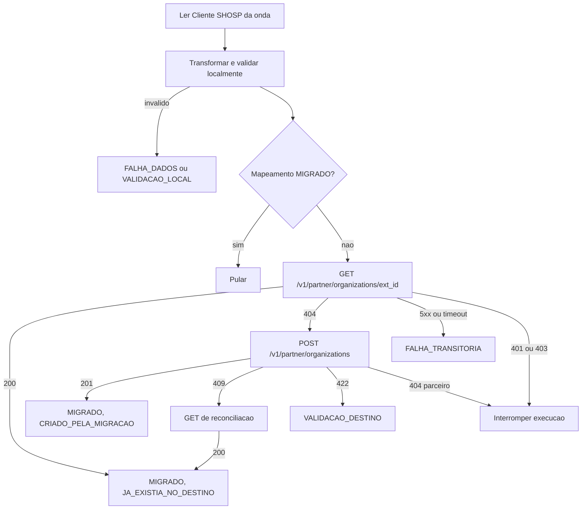

# PRD-01 — Migração de Organization (SHOSP)

Status: rascunho para revisão técnica. Data: 2026-10-26.

- PRD principal: [PRD-00 — Migração de dados do parceiro SHOSP](./PRD-00-migracao-shosp.md).
- Dependentes deste PRD: [PRD-02 — Physician](./PRD-02-physician.md), [PRD-03 — Patient](./PRD-03-patient.md) e, indiretamente, [PRD-04 — Prescription](./PRD-04-prescription.md).
- Cliente que executa este fluxo: [PRD-05 — Aplicação Python](./PRD-05-aplicacao-python.md).

Convenções iguais às do PRD principal: **[FATO]**, **[REQ]**, **[HIP]**, **[QA]** e **[REC]**. Abreviações: `MR` = `afya-prescription-monorepo/apps/prescription-backend/app`, `MZ` = `maagizo/backend`.

Os requisitos gerais (RF, RN, RNF e CA do PRD principal) valem integralmente aqui. Este documento só detalha o que é específico de Organization e usa o prefixo `ORG`.

---

## 1. Objetivo

Garantir que cada organização elegível do SHOSP exista uma única vez na Afya, sob o `partner_id` do SHOSP (`5b73f686-876b-4b81-b575-5a2df115fefd`), e que o mapeamento local (ID SHOSP para `external_id` de destino) fique registrado. Organization é a raiz da ordem de dependências (PRD-00, seção 7): nenhum Physician, Patient ou Prescription é enviado sem a organização mapeada.

## 2. Endpoints

Decisão [REQ]: consulta e criação usam a **superfície de parceiro do `prescription-backend`** (PRD-00, D-09 e D-09b).

### 2.1 Autenticação

- `Authorization: Bearer <PartnerToken>`, obtido em `POST /v1/partner/auth` com `client_id` e `client_secret` do client Keycloak do SHOSP (`MR/partner/entrypoint/rest/partner_auth_router.py`, linhas 17-43). O fluxo de obtenção e renovação do token está no PRD-05.
- O `partner_id` vem do claim `azp` do token, nunca do corpo (`MR/common/dependencies/partner_auth.py`, linhas 108-121) [FATO].
- O `POST` exige o papel `passwordless` em `realm_access.roles`. O `GET` só exige token válido (`MR/organization/entrypoint/rest/partner_organization_router.py`, linhas 36-46) [FATO].

### 2.2 Consulta prévia — `GET /v1/partner/organizations/{org_external_id}`

- Handler: `partner_organization_router.py`, linhas 85-113 [FATO].
- Resposta 200:

  ```json
  {
    "organization": {
      "external_id": "shosp-org-123",
      "name": "Clinica Exemplo",
      "cnes": "1234567",
      "sandbox": false,
      "created_at": "2026-10-26T12:00:00Z",
      "updated_at": "2026-10-26T12:00:00Z"
    }
  }
  ```

- Status: 200 (existe), 404 (não existe no escopo do parceiro), 401 (token inválido).
- A resposta **não traz o ID interno** (UUID) da organização [FATO: `partner_organization_schemas.py`, linhas 32-42]. O mapeamento local usa o `external_id` como chave de destino (PRD-00, RF-07).

### 2.3 Criação — `POST /v1/partner/organizations`

- Handler: `partner_organization_router.py`, linhas 49-82 [FATO].
- Request (`partner_organization_schemas.py`, linhas 17-21):

  | Campo | Tipo | Regra |
  | --- | --- | --- |
  | `external_id` | string | obrigatório, 1 a 36 caracteres, com `strip` |
  | `name` | string | opcional, até 256 caracteres, padrão `""` |
  | `cnes` | string ou nulo | opcional, até 7 caracteres |
  | `sandbox` | bool | opcional, padrão `false` |

- Resposta 201: `{"organization": {"external_id": "..."}}`.
- Status: 201, 401, 404 (parceiro não cadastrado), **409** (`external_id` já existe para o parceiro, `OrganizationExternalIdAlreadyExistsException`) e 422 (validação).
- Não emite webhook nem grava na `partner_webhook_outbox` [FATO], o que atende a RN-20.

### 2.4 Por que não o Maagizo

- [FATO] O Maagizo não tem `GET` de Organization por `external_id` em v1 nem em v2. Só existem `POST` e `PUT /v1/partner/orgs` e as equivalentes v2.
- [FATO] O `PUT /v1/partner/orgs` faz upsert com `ON CONFLICT (partner_id, external_id)` (`MZ/pkg/postgres/org_storage.go`, linha 54), o que poderia sobrescrever uma organização que já existia (contraria RN-07a).

## 3. Origem e mapeamento de campos

### 3.1 Tabela de origem

Organization vem de `cliente."Cliente"`, que guarda as contas e clínicas que usam a SHOSP [FATO: [guia de migração](https://afya-spm.atlassian.net/wiki/spaces/Tech/pages/1552482315/Guia+de+migra+o+-+prescri+o+legada)]. A ligação com as prescrições passa por `login."Usuario".frkCliente` e `prontuario."ProntuarioGrupo".frkUsuario` (PRD-00, seção 6.5.1).

| Coluna | Uso | Marcação |
| --- | --- | --- |
| `prk` | identificador da conta; base do `external_id` | [FATO: guia] |
| `nome` | nome da conta ou clínica | [FATO: guia] |
| `email`, `telefone1`, `celular` | não enviados (o contrato não tem esses campos) | [FATO: guia] |
| `ativo` | status do cliente, define a onda (PRD-00, seção 4.1) | [HIP] nome da coluna |
| `dataInativacao` | data de inativação; obrigatória para entrar nas ondas de inativos | [HIP] nome da coluna |

### 3.2 Query de leitura

Parte da CTE `wave_cliente` e `wave_group` (PRD-00, seção 6.5.3), que já aplica o status do cliente e a origem dos itens da onda. Só entram clientes com pelo menos um grupo de prontuário elegível na onda.

```sql
-- organizations.sql  (parametros: :wave_status, :wave_origin, :last_prk, :batch)
with wave_cliente as (...), wave_group as (...)   -- PRD-00, secao 6.5.3
select c.prk,
       c.nome,
       c.ativo,
       c."dataInativacao"
from cliente."Cliente" c
where c.prk in (select distinct cliente_id from wave_group)
  and c.prk > :last_prk
order by c.prk
limit :batch;
```

Na onda 1, isso devolve só os clientes inativos com data de inativação que têm prescrição legada. Nas ondas Memed, um cliente já `MIGRADO` numa onda legada é pulado pelo mapeamento local, sem chamada HTTP (RN-06 e RN-22).

### 3.3 Mapeamento de campos

| Destino | Origem SHOSP | Transformação | Marcação |
| --- | --- | --- | --- |
| `external_id` | `Cliente.prk` | regra RF-ORG-01 | [FATO: guia] / [QA] formato do `prk` |
| `name` | `Cliente.nome` | `strip`; truncamento proibido: acima de 256 é falha de dados | [FATO: guia] |
| `cnes` | — | `null`; o guia não documenta CNES no `Cliente` | [QA] existe CNES na SHOSP? |
| `sandbox` | — | sempre `false` em produção; configurável por ambiente | [REC] |

O status e a data de inativação só servem para a seleção. Não são enviados ao destino, porque o contrato de Organization não tem campo de status e a implementação não cria campos novos (RN-15).

## 4. Requisitos específicos

- **RF-ORG-01 — `external_id`:** derivado do ID SHOSP de forma estável e reversível, com no máximo 36 caracteres (RN-02). [REC] Usar o ID de origem sem prefixo quando ele já couber em 36 caracteres e for único na origem. Se for preciso prefixar (por exemplo, `shosp-<id>`), o prefixo vale para todas as entidades e fica na configuração da aplicação. [QA] Formato real do ID SHOSP.
- **RF-ORG-02 — Consulta antes da criação:** aplica o RF-02a do principal. Um 200 grava o mapeamento `MIGRADO` com origem `JA_EXISTIA_NO_DESTINO`, sem `POST` nem `PATCH`.
- **RF-ORG-03 — Conflito na criação:** um 409 no `POST` é tratado como corrida entre consulta e criação. A aplicação refaz o `GET` (RF-18) e grava o mapeamento com origem `JA_EXISTIA_NO_DESTINO`.
- **RF-ORG-04 — Sem `PATCH`:** a migração nunca chama `PATCH /v1/partner/organizations/{org_external_id}` (RN-07a).
- **RF-ORG-05 — Validação local:** antes do envio, a aplicação valida tamanho de `external_id`, `name` e `cnes` (mesmas regras da seção 2.3). Violação gera `VALIDACAO_LOCAL`, sem chamada HTTP.
- **RF-ORG-06 — Dependentes:** só depois do mapeamento `MIGRADO` de uma organização os Physicians e Patients dela ficam elegíveis (RF-14).

## 5. Fluxo



Um 404 no `POST` indica que o parceiro do token não está cadastrado na tabela `partner`. É falha de configuração do ambiente e interrompe a execução, como as de autenticação.

## 6. Critérios de aceite

- **CA-ORG-01:** Dado uma organização SHOSP sem mapeamento e inexistente no destino, quando processada, então o `POST` retorna 201 e o mapeamento fica `MIGRADO` com `CRIADO_PELA_MIGRACAO` e o `external_id` enviado (CA-01 do principal).
- **CA-ORG-02:** Dado uma organização que já existe no destino com o mesmo `external_id`, quando processada, então só o `GET` é chamado e o mapeamento fica `MIGRADO` com `JA_EXISTIA_NO_DESTINO` (CA-06).
- **CA-ORG-03:** Dado um `POST` que retorna 409, quando tratado, então a aplicação faz o `GET` de reconciliação e grava o mapeamento, sem registrar falha.
- **CA-ORG-04:** Dado um `cnes` com mais de 7 caracteres na origem, quando transformado, então não há chamada HTTP e é registrada uma falha `VALIDACAO_LOCAL` com o campo e a regra.
- **CA-ORG-05:** Dado um token sem o papel `passwordless`, quando o primeiro `POST` retorna 403, então a execução é interrompida com categoria `AUTENTICACAO`.
- **CA-ORG-06:** Dado que a organização foi migrada, quando a tabela `organization` é consultada, então `partner_id` é o do SHOSP e nenhum evento foi gravado na `partner_webhook_outbox`.
- **CA-ORG-07:** Dado uma execução da onda 1, quando concluída, então só foram processados clientes inativos com data de inativação que têm pelo menos uma prescrição legada (CA-24).
- **CA-ORG-08:** Dado um cliente inativo sem data de inativação, quando qualquer onda é executada, então ele não é lido pela query da seção 3.2 e aparece no relatório como "status indefinido" (CA-25).

## 7. Pendências

- [QA] Formato e unicidade de `Cliente.prk` (RF-ORG-01).
- [QA] Nomes reais das colunas de status e de data de inativação do `Cliente` (seção 3.1).
- [QA] Existe CNES na SHOSP? Se existir, em qual tabela.
- [QA] Clientes com `nome` vazio: falha de dados ou envio com `name = ""` (o contrato permite)?
- [QA] Tratamento de clientes inativos sem data de inativação e de clientes que mudam de status entre ondas (PRD-00, D-12).
- Resolvida: organizações desativadas são elegíveis. Elas formam as ondas 1 e 3 (PRD-00, seção 4.1).
- [QA] Cadastro do SHOSP na tabela `partner` e client Keycloak com papel `passwordless` em cada ambiente (PRD-00, seção 17, item 3).

## 8. Referências

- [Guia de migração - prescrição legada](https://afya-spm.atlassian.net/wiki/spaces/Tech/pages/1552482315/Guia+de+migra+o+-+prescri+o+legada)
- `MR/organization/entrypoint/rest/partner_organization_router.py`
- `MR/organization/entrypoint/rest/partner_organization_schemas.py`
- `MR/partner/entrypoint/rest/partner_auth_router.py`
- `MR/common/dependencies/partner_auth.py`
- `MZ/pkg/postgres/org_storage.go`
