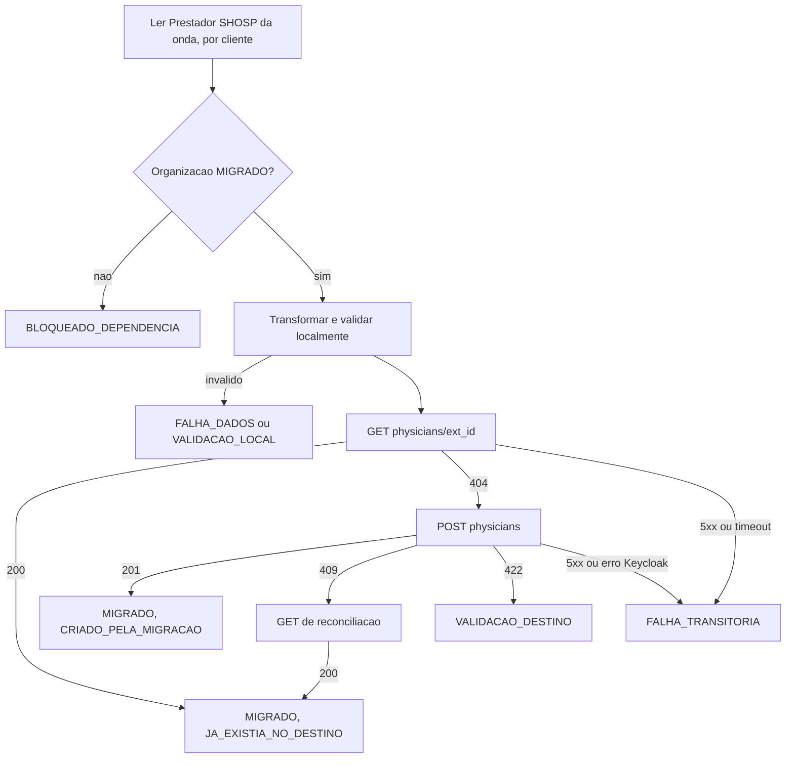

# PRD-02 — Migração de Physician (SHOSP)

Status: rascunho para revisão técnica. Data: 2026-10-26.

- PRD principal: [PRD-00 — Migração de dados do parceiro SHOSP](./PRD-00-migracao-shosp.md).
- Depende de: [PRD-01 — Organization](./PRD-01-organization.md).
- Dependente deste PRD: [PRD-04 — Prescription](./PRD-04-prescription.md).
- Cliente que executa este fluxo: [PRD-05 — Aplicação Python](./PRD-05-aplicacao-python.md).

Convenções iguais às do PRD principal: **[FATO]**, **[REQ]**, **[HIP]**, **[QA]** e **[REC]**. Abreviações: `MR` = `afya-prescription-monorepo/apps/prescription-backend/app`, `MZ` = `maagizo/backend`.

Os requisitos gerais do PRD principal valem integralmente aqui. Este documento só detalha o que é específico de Physician e usa o prefixo `PHY`.

---

## 1. Objetivo

Garantir que cada médico elegível do SHOSP exista uma única vez por organização na Afya, com `external_id` único dentro da organização (`(org_id, external_id)`), e que o mapeamento local fique registrado. Physician roda depois de Organization e pode rodar em paralelo com Patient (PRD-00, seção 7).

## 2. Endpoints

Decisão [REQ]: consulta e criação usam a **superfície de parceiro do `prescription-backend`** (PRD-00, D-09 e D-09b). Autenticação igual à do PRD-01, seção 2.1: `PartnerToken`, com `partner_id` vindo do claim `azp`. O `POST` exige o papel `passwordless` (`MR/physician/entrypoint/rest/partner_physician_router.py`, linhas 45-55) [FATO].

### 2.1 Consulta prévia — `GET /v1/partner/organizations/{org_external_id}/physicians/{physician_external_id}`

- Handler: `partner_physician_router.py`, linhas 135-160 [FATO].
- Resposta 200: `{"physician": {...}}` com `external_id`, `name`, `email`, `document`, `cns`, `registry_council`, `registry_number`, `registry_state`, `phone`, `cbo_code`, `address`, `created_at` e `updated_at` (`MR/physician/entrypoint/rest/partner_physician_schemas.py`, linhas 116-138).
- A resposta **exclui de propósito** `id`, `org_id` e `prescription_auth_id` [FATO]. O mapeamento local usa o par (`org_external_id`, `physician_external_id`) como chave de destino.
- Status: 200, 404 (organização ou médico inexistente) e 401.

### 2.2 Criação — `POST /v1/partner/organizations/{org_external_id}/physicians`

- Handler: `partner_physician_router.py`, linhas 84-132; use case `MR/physician/usecases/create_partner_physician_usecase.py` [FATO].
- Request (`partner_physician_schemas.py`, linhas 70-83):

  | Campo | Regra |
  | --- | --- |
  | `external_id` | obrigatório, 1 a 36 caracteres |
  | `name` | obrigatório, 1 a 256 caracteres |
  | `email` | obrigatório, e-mail válido, até 256 caracteres |
  | `document` | opcional; CPF com ou sem máscara, validado pelos dígitos verificadores e normalizado para `000.000.000-00` (`MR/physician/service/normalization.py`) |
  | `cns` | opcional |
  | `registry_council` | opcional; valor da lista `COUNCILS` (`CRM`, `CRO`, `COREN`, `CRF`, `CRN`, `CRP`, `OUTROS` etc., em `MR/utils/validation.py`) |
  | `registry_number` | opcional, até 10 caracteres |
  | `registry_state` | opcional; UF válida |
  | `phone` | opcional; formato E.164 (`+5511999999999`) |
  | `cbo_code` | opcional |
  | `address` | opcional; `address` (até 512), `number` (até 20), `complement` (até 100), `neighborhood` (até 100), `city` (até 64), `state` (UF) e `zip_code` (8 dígitos) |

- Resposta 201: `{"physician": {"external_id": "..."}}`.
- Status: 201, 401, 403, 404 (organização inexistente), **409** (`PhysicianExternalIdAlreadyExistsException`) e 422.
- Não emite webhook na criação [FATO].

### 2.3 Efeito colateral: usuário no PrescriptionAuth

[FATO] Antes de gravar, o `POST` faz **find-or-create de um usuário no PrescriptionAuth (Keycloak)** pelo e-mail do médico (`MR/physician/service/link_partner_physician_auth_service.py`). Se a gravação falhar depois de criar o usuário, o use case tenta apagá-lo (compensação best-effort). Consequências para a migração:

- Cada médico migrado com e-mail novo ganha um usuário no Keycloak. [QA] Isso é desejado para todos os médicos SHOSP, inclusive inativos?
- O mesmo e-mail em duas organizações reaproveita o mesmo usuário de autenticação.
- Uma falha do Keycloak aborta a criação. A aplicação trata como `COMUNICACAO` (transitória) quando o status for 5xx.
- A carga sobre o Keycloak entra no controle de taxa do endpoint de Physician (RNF-06).

### 2.4 Por que não o Maagizo

- [FATO] O Maagizo v1 não tem `GET` de Physician. O `PUT /v1/partner/orgs/physicians` faz upsert e pode alterar um médico que já existia (contraria RN-07a).
- [FATO] O Maagizo v2 tem `GET /v2/orgs/:orgExternalId/physicians/:physicianExternalId`, mas o grupo v2 não tem autenticação na aplicação (`partnerId` vem da query) e o `PUT` v2 sobrescreve o `externalId` do médico com o da organização (`MZ/pkg/http/restecho/routes/partner/put_org_physicians_v2.go`, linhas 41-43).

## 3. Origem e mapeamento de campos

### 3.1 Tabela de origem

Physician vem de `shosp."Prestador"`, que guarda os profissionais de saúde [FATO: [guia de migração](https://afya-spm.atlassian.net/wiki/spaces/Tech/pages/1552482315/Guia+de+migra+o+-+prescri+o+legada)]. A ligação com a organização vem do grupo do prontuário: `ProntuarioGrupo.frkPrestador` dá o médico, e o cliente do usuário do grupo (`login."Usuario".frkCliente`) dá a organização (PRD-00, seção 6.5.1).

| Coluna | Uso | Marcação |
| --- | --- | --- |
| `prk` | identificador do prestador; base do `external_id` | [FATO: guia] |
| `nome`, `razaoSocial` | nome do profissional | [FATO: guia] |
| `cpf` | documento | [FATO: guia] |
| `cnpj` | não enviado (o contrato só aceita CPF) | [FATO: guia] |
| `cns` | Cartão Nacional de Saúde | [FATO: guia] |
| `email` | e-mail, obrigatório no destino | [FATO: guia] |
| `sexo`, `dataNascimento` | não enviados (o contrato não tem esses campos) | [FATO: guia] |
| `codigoMemed` | não usado; a integração Memed do prestador não é migrada | [FATO: guia] |
| conselho, número e UF do registro | não documentados no guia | [QA] |

### 3.2 Query de leitura

Um registro por par (prestador, cliente), restrito aos grupos elegíveis da onda (CTE da PRD-00, seção 6.5.3). Na onda 1, isso devolve só os médicos que têm prescrição legada em clientes inativos com data de inativação.

```sql
-- physicians.sql  (parametros: :wave_status, :wave_origin, :last_cliente, :last_prk, :batch)
with wave_cliente as (...), wave_group as (...)   -- PRD-00, secao 6.5.3
, wave_physician as (
  select distinct cliente_id, prestador_id from wave_group
)
select wp.cliente_id,
       pt.prk,
       pt.nome,
       pt."razaoSocial",
       pt.cpf,
       pt.cns,
       pt.email
from wave_physician wp
join shosp."Prestador" pt on pt.prk = wp.prestador_id
where (wp.cliente_id, pt.prk) > (:last_cliente, :last_prk)
order by wp.cliente_id, pt.prk
limit :batch;
```

A paginação é keyset pelo par (`cliente_id`, `prk`), que também é a chave do mapeamento local (RF-PHY-02).

### 3.3 Mapeamento de campos

| Destino | Origem SHOSP | Transformação | Marcação |
| --- | --- | --- | --- |
| `org_external_id` (path) | `cliente_id` | resolvido pelo mapeamento local do PRD-01 | [REQ] |
| `external_id` | `Prestador.prk` | mesma regra de prefixo do RF-ORG-01; o mesmo valor em cada organização | [FATO: guia] |
| `name` | `Prestador.nome`; se vazio, `razaoSocial` | `strip` | [REC] |
| `email` | `Prestador.email` | minúsculas e `strip`; ausente ou inválido é falha de dados | [FATO: guia] / [QA] correção |
| `document` | `Prestador.cpf` | só dígitos; CPF inválido vira `null` ou falha (pendência) | [FATO: guia] |
| `cns` | `Prestador.cns` | só dígitos; vazio vira `null` | [FATO: guia] |
| `registry_council` | — | tabela de-para para `COUNCILS`, se a coluna existir | [QA] |
| `registry_number` | — | só dígitos, se a coluna existir | [QA] |
| `registry_state` | — | UF maiúscula, se a coluna existir | [QA] |
| `phone` | — | não documentado no `Prestador`; `null` | [QA] |
| `cbo_code` | — | não documentado; `null` | [QA] |
| `address` | — | não documentado; omitido | [QA] |

## 4. Requisitos específicos

- **RF-PHY-01 — Dependência:** o médico só é enviado depois que a organização dele estiver `MIGRADO` (RF-14). O `org_external_id` vem do mapeamento local, nunca da origem diretamente.
- **RF-PHY-02 — Médico em várias organizações:** a organização vem do grupo do prontuário, então o mesmo `Prestador` pode aparecer em mais de um `Cliente`. A migração cria um registro por organização, com o mesmo `external_id` em cada uma. A chave do mapeamento local é (`Prestador.prk`, `Cliente.prk`). Um médico com prescrições num cliente inativo e num ativo é migrado na onda 1 para o primeiro e na onda 2 para o segundo.
- **RF-PHY-08 — Recorte da onda:** só são lidos os médicos que aparecem em `wave_group` na onda da execução (PRD-00, seção 4.1). Um médico sem prescrição elegível no cliente não é migrado para aquela organização.
- **RF-PHY-03 — Consulta antes da criação:** aplica o RF-02a. Um 200 grava `MIGRADO` com `JA_EXISTIA_NO_DESTINO`, sem `POST` nem `PATCH`.
- **RF-PHY-04 — Conflito:** um 409 no `POST` dispara o `GET` de reconciliação (RF-18).
- **RF-PHY-05 — Validação local:** antes do envio, a aplicação valida e-mail, CPF (dígitos verificadores), conselho, UF, tamanho do registro, telefone E.164 e CEP com as mesmas regras do destino. Violação gera `VALIDACAO_LOCAL`.
- **RF-PHY-06 — E-mail obrigatório:** médico sem e-mail válido na origem é `FALHA_DADOS`. A aplicação não inventa e-mail. [QA] Política de correção (PRD-00, RN-05).
- **RF-PHY-07 — Sem `PATCH`:** a migração nunca chama `PATCH .../physicians/{physician_external_id}`.

## 5. Fluxo



Um 404 no `POST` com a organização mapeada indica mapeamento inconsistente. A aplicação reconcilia a organização (`GET` do PRD-01) antes de qualquer nova tentativa.

## 6. Critérios de aceite

- **CA-PHY-01:** Dado um médico SHOSP válido cuja organização está mapeada, quando processado e inexistente no destino, então o `POST` retorna 201 e o mapeamento fica `MIGRADO` com `CRIADO_PELA_MIGRACAO`.
- **CA-PHY-02:** Dado um médico que já existe no destino na mesma organização, quando processado, então só o `GET` é chamado e o mapeamento fica `JA_EXISTIA_NO_DESTINO`.
- **CA-PHY-03:** Dado um médico cuja organização não está mapeada, quando selecionado, então fica `BLOQUEADO_DEPENDENCIA`, sem chamada HTTP (CA-10).
- **CA-PHY-04:** Dado um médico sem e-mail na origem, quando transformado, então é registrada uma falha de dados com o campo `email`, sem expor outros dados pessoais.
- **CA-PHY-05:** Dado um conselho de origem sem correspondência em `COUNCILS`, quando transformado, então o resultado segue a regra decidida na pendência de de-para (falha de dados ou `OUTROS`).
- **CA-PHY-06:** Dado um erro 5xx causado pelo PrescriptionAuth na criação, quando tratado, então o registro fica `FALHA_TRANSITORIA`, reprocessável, e nenhum médico é gravado no destino.
- **CA-PHY-07:** Dado um `Prestador` com prescrições em dois clientes, quando as ondas desses clientes são executadas, então existem dois médicos no destino, um em cada organização, com o mesmo `external_id`.
- **CA-PHY-08:** Dado uma execução da onda 1, quando concluída, então só foram processados médicos com prescrição legada em clientes inativos com data de inativação.

## 7. Pendências

- [QA] Colunas de conselho, número e UF do registro no `Prestador` (não documentadas no guia) e a tabela de-para para `COUNCILS`.
- [QA] Criação de usuários no PrescriptionAuth para todos os médicos migrados (seção 2.3). Na onda 1, isso inclui médicos de clientes que não usam mais a SHOSP. É desejado?
- [QA] Prestador com `cnpj` e sem `cpf`: enviar sem `document` ou falhar?
- [QA] Médicos sem registro profissional são elegíveis?
- Resolvida: a relação médico-organização vem do grupo do prontuário (RF-PHY-02).

## 8. Referências

- [Guia de migração - prescrição legada](https://afya-spm.atlassian.net/wiki/spaces/Tech/pages/1552482315/Guia+de+migra+o+-+prescri+o+legada)
- `MR/physician/entrypoint/rest/partner_physician_router.py`
- `MR/physician/entrypoint/rest/partner_physician_schemas.py` e `MR/physician/entrypoint/rest/schemas.py` (`ServiceAddressRequest`)
- `MR/physician/usecases/create_partner_physician_usecase.py`
- `MR/physician/service/link_partner_physician_auth_service.py` e `MR/physician/service/normalization.py`
- `MR/utils/validation.py`
- `MZ/pkg/http/restecho/routes/partner/put_org_physicians_v2.go`
