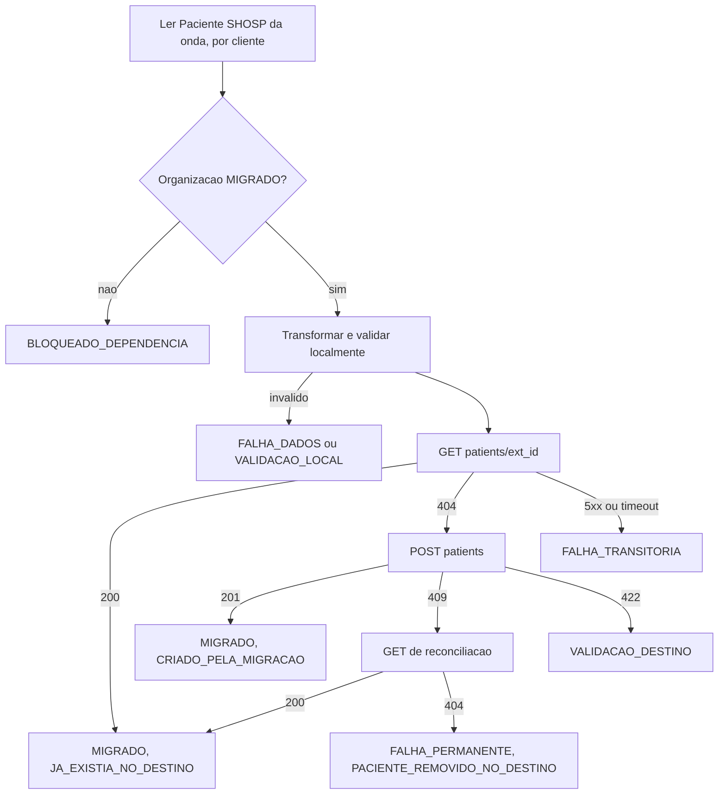

# PRD-03 — Migração de Patient (SHOSP)

Status: rascunho para revisão técnica. Data: 2026-10-26.

- PRD principal: [PRD-00 — Migração de dados do parceiro SHOSP](./PRD-00-migracao-shosp.md).
- Depende de: [PRD-01 — Organization](./PRD-01-organization.md).
- Dependente deste PRD: [PRD-04 — Prescription](./PRD-04-prescription.md).
- Cliente que executa este fluxo: [PRD-05 — Aplicação Python](./PRD-05-aplicacao-python.md).

Convenções iguais às do PRD principal: **[FATO]**, **[REQ]**, **[HIP]**, **[QA]** e **[REC]**. Abreviações: `MR` = `afya-prescription-monorepo/apps/prescription-backend/app`, `MZ` = `maagizo/backend`.

Os requisitos gerais do PRD principal valem integralmente aqui. Este documento só detalha o que é específico de Patient e usa o prefixo `PAT`.

---

## 1. Objetivo

Garantir que cada paciente elegível do SHOSP exista uma única vez por organização na Afya (`(org_id, external_id)`), e que o mapeamento local fique registrado. O destino não vincula paciente a médico [FATO], então Patient depende só de Organization e pode rodar em paralelo com Physician.

## 2. Endpoints

Decisão [REQ]: consulta e criação usam a **superfície de parceiro do `prescription-backend`** (PRD-00, D-09 e D-09b). Autenticação: `PartnerToken`, com `partner_id` vindo do claim `azp`. As rotas de paciente de parceiro exigem token válido, sem papel específico (`MR/patient/entrypoint/rest/partner_patient_router.py`) [FATO].

### 2.1 Consulta prévia — `GET /v1/partner/organizations/{org_external_id}/patients/{external_id}`

- Handler: `partner_patient_router.py`, linhas 150-171 [FATO].
- Resposta 200: `{"patient": {...}}` com `external_id`, `civil_name`, `social_name`, `document`, `document_type`, `birth_date`, `sex`, `email`, `phone`, `weight`, `height`, `mothers_name` e `address` (`MR/patient/entrypoint/rest/partner_schemas.py`, linhas 94-113). **Sem o ID interno.**
- Status: 200, 401 e 404. O 404 vale para organização inexistente, paciente inexistente **e paciente removido logicamente** (`deleted_at` preenchido) [FATO: `get_partner_patient_usecase.py`, linha 21].

### 2.2 Criação — `POST /v1/partner/organizations/{org_external_id}/patients`

- Handler: `partner_patient_router.py`, linhas 61-111; service `MR/patient/service/create_partner_patient_service.py` [FATO].
- Request (`partner_schemas.py`, linhas 26-41):

  | Campo | Regra |
  | --- | --- |
  | `external_id` | obrigatório, 1 a 36 caracteres |
  | `civil_name` e `social_name` | até 128 caracteres cada; **pelo menos um** é obrigatório |
  | `document` e `document_type` | acoplados: um exige o outro. `document_type` é `CPF` ou `PASSPORT` |
  | CPF | **com máscara** `000.000.000-00` e dígitos verificadores válidos (`MR/patient/service/validate_document_service.py`) |
  | Passaporte | 6 a 20 caracteres alfanuméricos; gravado em maiúsculas |
  | `birth_date` | data ISO |
  | `sex` | `male` ou `female` |
  | `phone` | E.164 |
  | `email` | texto livre |
  | `weight` | quilogramas, maior que 0 e até 999,999, 3 casas decimais |
  | `height` | **centímetros**, inteiro, maior que 0 e até 300 |
  | `mothers_name` | até 128 caracteres |
  | `address` | `address` (512), `number` (20), `complement` (100), `neighborhood` (100), `city` (64), `state` (2) e `zip_code` (8) |

- Sem documento: o destino grava `has_no_cpf = true` automaticamente [FATO: `create_partner_patient_service.py`]. Paciente estrangeiro é representado por `document_type = PASSPORT`. Os campos `hasNoCpf`, `isForeignPatient` e `passport` citados no RF-05 do principal pertencem às rotas internas e ao Maagizo, não a este contrato.
- Resposta 201: `{"patient": {"external_id": "..."}}`.
- Status: 201, 401, 404 (organização), **409** (`external_id` já existe, **inclusive removido logicamente**) e 422.
- Não emite webhook [FATO].

### 2.3 Por que a superfície de parceiro é obrigatória

- [FATO] O `POST /v1/physicians/{physician_external_id}/patients` (rota interna) grava `patient.created` na outbox e publica webhook (`MR/patient/usecases/create_patient_usecase.py`, linhas 29-37), o que viola RN-20.
- [FATO] No Maagizo, a criação de paciente só existe em `PUT /v1/physician/patients`, que exige JWT de médico e faz upsert por `externalId`. O `GET /v2/physicians/:physicianExternalId/patients/:patientExternalId` existe, mas o grupo v2 não tem autenticação na aplicação.

## 3. Origem e mapeamento de campos

### 3.1 Tabelas de origem

Patient vem de `shosp."Paciente"`, com cidade e UF de `shosp."Cidade"` e `shosp."Estado"` [FATO: [guia de migração](https://afya-spm.atlassian.net/wiki/spaces/Tech/pages/1552482315/Guia+de+migra+o+-+prescri+o+legada), query 2.1]. A ligação com a organização vem do grupo do prontuário: `ProntuarioGrupo.frkServicoPrestado` → `ServicoPrestado.frkAtendimento` → `Atendimento.frkPaciente` dá o paciente, e o cliente do usuário do grupo dá a organização (PRD-00, seção 6.5.1).

| Coluna | Uso | Marcação |
| --- | --- | --- |
| `prk` | identificador do paciente; base do `external_id` | [FATO: guia] |
| `nome` | nome completo | [FATO: guia] |
| `apelido` | nome social ou apelido | [FATO: guia] |
| `nomeMae` | nome da mãe | [FATO: guia, query 2.1] |
| `cpf` | documento | [FATO: guia] |
| `dataNascimento` | data de nascimento | [FATO: guia] |
| `sexo` | sexo | [FATO: guia] / [QA] valores |
| `email`, `celular`, `telefone` | contato | [FATO: guia] |
| `cep`, `logradouro`, `numero`, `bairro`, `complementoendereco`, `frkCidadeResidencia` | endereço | [FATO: guia] |
| `Cidade.nome`, `Estado.uf` | cidade e UF, por `frkCidadeResidencia` → `Cidade.frkEstado` | [FATO: guia, query 2.1] |

O guia não tem passaporte, peso nem altura (a query 2.1 devolve `null as weight, null as height`).

### 3.2 Query de leitura

Um registro por par (paciente, cliente), restrito aos grupos elegíveis da onda (CTE do PRD-00, seção 6.5.3). Na onda 1, isso devolve só os pacientes com prescrição legada em clientes inativos com data de inativação.

```sql
-- patients.sql  (parametros: :wave_status, :wave_origin, :last_cliente, :last_prk, :batch)
with wave_cliente as (...), wave_group as (...)   -- PRD-00, secao 6.5.3
, wave_patient as (
  select distinct cliente_id, paciente_id from wave_group
)
select wp.cliente_id,
       pac.prk,
       pac.nome,
       pac.apelido,
       pac."nomeMae",
       pac.cpf,
       pac."dataNascimento",
       pac.sexo,
       pac.email,
       pac.celular,
       pac.telefone,
       pac.cep,
       pac.logradouro,
       pac.numero,
       pac.bairro,
       pac.complementoendereco,
       c.nome as cidade,
       e.uf
from wave_patient wp
join shosp."Paciente" pac on pac.prk = wp.paciente_id
left join shosp."Cidade" c on c.prk = pac."frkCidadeResidencia"
left join shosp."Estado" e on e.prk = c."frkEstado"
where (wp.cliente_id, pac.prk) > (:last_cliente, :last_prk)
order by wp.cliente_id, pac.prk
limit :batch;
```

A paginação é keyset pelo par (`cliente_id`, `prk`), que também é a chave do mapeamento local (RF-PAT-02).

### 3.3 Mapeamento de campos

| Destino | Origem SHOSP | Transformação | Marcação |
| --- | --- | --- | --- |
| `org_external_id` (path) | `cliente_id` | resolvido pelo mapeamento local do PRD-01 | [REQ] |
| `external_id` | `Paciente.prk` | mesma regra de prefixo do RF-ORG-01 | [FATO: guia] |
| `civil_name` | `Paciente.nome` | `strip`; até 128 caracteres, acima é falha de dados | [FATO: guia] |
| `social_name` | `Paciente.apelido` | `strip`; vazio vira `null` | [FATO: guia] / [QA] apelido equivale a nome social? |
| `document` e `document_type` | `Paciente.cpf` | só dígitos, depois máscara `000.000.000-00`, com `document_type = CPF`; vazio omite os dois | [FATO: guia] |
| `birth_date` | `Paciente.dataNascimento` | ISO `YYYY-MM-DD` | [FATO: guia] |
| `sex` | `Paciente.sexo` | de-para para `male` ou `female`; outros valores viram `null` | [QA] valores na origem |
| `phone` | `Paciente.celular`; se vazio, `telefone` | normalizar para E.164 com `+55`; impossível normalizar vira `null` | [REC] |
| `email` | `Paciente.email` | `strip` | [FATO: guia] |
| `weight` e `height` | — | `null` (não existem na origem) | [FATO: guia] |
| `mothers_name` | `Paciente.nomeMae` | `strip`; até 128 caracteres | [FATO: guia] |
| `address.address` | `logradouro` | `strip`; até 512 | [FATO: guia] |
| `address.number` | `numero` | até 20 | [FATO: guia] |
| `address.complement` | `complementoendereco` | até 100 | [FATO: guia] |
| `address.neighborhood` | `bairro` | até 100 | [FATO: guia] |
| `address.city` | `Cidade.nome` | até 64 | [FATO: guia] |
| `address.state` | `Estado.uf` | 2 letras maiúsculas | [FATO: guia] |
| `address.zip_code` | `cep` | só dígitos, 8 caracteres; diferente disso omite o CEP | [REC] |

## 4. Requisitos específicos

- **RF-PAT-01 — Dependência:** o paciente só é enviado depois que a organização dele estiver `MIGRADO` (RF-14). Não há dependência de Physician.
- **RF-PAT-02 — Paciente compartilhado:** a organização vem do grupo do prontuário, então o mesmo `Paciente` pode aparecer em mais de um `Cliente`. A migração cria um registro por organização, e a chave do mapeamento local é (`Paciente.prk`, `Cliente.prk`).
- **RF-PAT-08 — Recorte da onda:** só são lidos os pacientes que aparecem em `wave_group` na onda da execução (PRD-00, seção 4.1). Pacientes sem prescrição elegível no cliente não são migrados.
- **RF-PAT-03 — Consulta antes da criação:** aplica o RF-02a. Um 200 grava `MIGRADO` com `JA_EXISTIA_NO_DESTINO`, sem `POST` nem `PATCH`.
- **RF-PAT-04 — Paciente removido logicamente:** o `GET` responde 404 e o `POST` seguinte responde 409. Como o `GET` de reconciliação também responde 404, a aplicação classifica o caso como **`CONFLITO` não reconciliável**, estado `FALHA_PERMANENTE`, com o motivo `PACIENTE_REMOVIDO_NO_DESTINO`. [QA] Confirmar com o produto (a pendência herdada do RF-02a do principal). As prescrições desse paciente ficam `BLOQUEADO_DEPENDENCIA`.
- **RF-PAT-05 — Validação local:** antes do envio, a aplicação valida nome (civil ou social), par documento e tipo, CPF com máscara e dígitos verificadores, passaporte, telefone, peso, altura e CEP com as mesmas regras do destino. Violação gera `VALIDACAO_LOCAL`.
- **RF-PAT-06 — Sem `PATCH`:** a migração nunca chama `PATCH .../patients/{external_id}`.
- **RF-PAT-07 — LGPD:** o banco de controle guarda só IDs e metadados do paciente. Mensagens de erro citam campo e regra, sem CPF, nome, telefone ou e-mail (RNF-03 e CA-13).

## 5. Fluxo



## 6. Critérios de aceite

- **CA-PAT-01:** Dado um paciente SHOSP válido cuja organização está mapeada, quando processado e inexistente no destino, então o `POST` retorna 201 e o mapeamento fica `MIGRADO` com `CRIADO_PELA_MIGRACAO`.
- **CA-PAT-02:** Dado um paciente que já existe no destino, quando processado, então só o `GET` é chamado e o mapeamento fica `JA_EXISTIA_NO_DESTINO`, sem alterar nenhum dado do paciente.
- **CA-PAT-03:** Dado um paciente sem CPF nem passaporte na origem, quando migrado, então é enviado sem `document` e `document_type`, e o destino grava `has_no_cpf = true`.
- **CA-PAT-04:** Dado um paciente com CPF inválido, quando transformado, então não há chamada HTTP e a falha cita o campo `document`, sem o valor (CA-02).
- **CA-PAT-05:** Dado um paciente removido logicamente no destino com o mesmo `external_id`, quando processado, então o registro fica `FALHA_PERMANENTE` com o motivo `PACIENTE_REMOVIDO_NO_DESTINO`, e as prescrições dele ficam bloqueadas.
- **CA-PAT-06:** Dado a migração de pacientes, quando concluída, então nenhum evento `patient.created` foi gravado na `partner_webhook_outbox`.
- **CA-PAT-07:** Dado um paciente com prescrições em dois clientes, quando as ondas desses clientes são executadas, então existem dois pacientes no destino, um em cada organização, com o mesmo `external_id`.
- **CA-PAT-08:** Dado uma execução da onda 1, quando concluída, então só foram processados pacientes com prescrição legada em clientes inativos com data de inativação.

## 7. Pendências

- [QA] Tratamento do paciente removido logicamente (RF-PAT-04).
- [QA] Valores de `Paciente.sexo` na origem, para o de-para.
- [QA] `apelido` equivale a nome social, ou deve ser ignorado?
- [QA] Pacientes falecidos ou inativos são elegíveis? Existe coluna de exclusão lógica no `Paciente`?
- Resolvida: a relação paciente-organização vem do grupo do prontuário (RF-PAT-02). Peso e altura não existem na origem.
- [QA] Política para CPF inválido na origem: migrar sem documento ou falhar (PRD-00, RN-05).

## 8. Referências

- [Guia de migração - prescrição legada](https://afya-spm.atlassian.net/wiki/spaces/Tech/pages/1552482315/Guia+de+migra+o+-+prescri+o+legada)
- `MR/patient/entrypoint/rest/partner_patient_router.py`
- `MR/patient/entrypoint/rest/partner_schemas.py`
- `MR/patient/service/create_partner_patient_service.py` e `MR/patient/service/validate_document_service.py`
- `MR/patient/usecases/get_partner_patient_usecase.py` e `MR/patient/usecases/create_patient_usecase.py`
- `MZ/pkg/http/restecho/routes/router/version2/physician.go`
