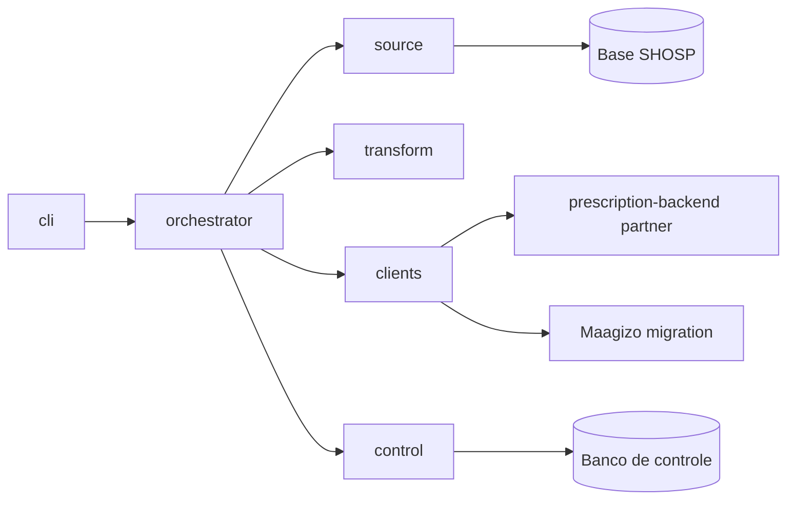

# PRD-05 — Aplicação Python de migração SHOSP

Status: rascunho para revisão técnica. Data: 2026-10-26.

- PRD principal: [PRD-00 — Migração de dados do parceiro SHOSP](./PRD-00-migracao-shosp.md). Este documento especifica a "aplicação local" das seções 1, 7, 8, 11, 12 e 13 do principal.
- Endpoints chamados: [PRD-01 — Organization](./PRD-01-organization.md), [PRD-02 — Physician](./PRD-02-physician.md), [PRD-03 — Patient](./PRD-03-patient.md) e [PRD-04 — Prescription](./PRD-04-prescription.md).

Convenções iguais às do PRD principal: **[FATO]**, **[REQ]**, **[HIP]**, **[QA]** e **[REC]**. Este documento usa o prefixo `APP`.

---

## 1. Objetivo

Construir uma aplicação de linha de comando, em Python e em **repositório próprio** [REQ, D-08], que:

1. lê a base SHOSP com usuário somente leitura;
2. transforma os registros para os contratos dos PRDs 01 a 04;
3. consulta e cria Organization, Physician e Patient na superfície de parceiro do `prescription-backend`;
4. cria Prescription no endpoint novo do Maagizo;
5. mantém um banco local de controle com execuções, mapeamentos, tentativas e dependências.

## 2. Stack [REC]

| Item | Escolha | Motivo |
| --- | --- | --- |
| Linguagem | Python 3.13 | mesma versão do `prescription-backend` |
| Pacotes | `uv` | padrão do time |
| HTTP | `httpx` assíncrono | timeouts, pool e transport mockável nos testes |
| Contratos | `pydantic` v2 | validação local igual à do destino |
| Logs | `structlog` (JSON) | logs estruturados (RNF-04) |
| CLI | `typer` | subcomandos e ajuda gerados a partir das assinaturas |
| Banco de controle | SQLAlchemy 2.0 assíncrono, com SQLite ou PostgreSQL local | decisão D-02 pendente; o SQLAlchemy permite trocar sem reescrever |
| Leitura da origem | `asyncpg` | a SHOSP é PostgreSQL [HIP forte: sintaxe do guia de migração, PRD-00, seção 6.5]; queries em `.sql` com parâmetros nomeados |
| Retry | `tenacity` | backoff exponencial com jitter (D-07) |
| Testes | `pytest`, `pytest-asyncio`, `respx` | mocks HTTP sem servidor |

## 3. Arquitetura

Camadas separadas (RNF-08), dependência sempre de fora para dentro:

```
shosp_migration/
  config/          # settings por ambiente (pydantic-settings), sem segredos no código
  source/          # leitura SHOSP: arquivos .sql por entidade e fonte de item, filtrados pela onda
  transform/       # funções puras origem -> contrato destino, uma por entidade
  contracts/       # modelos pydantic dos requests e responses dos PRDs 01 a 04
  clients/         # MonorepoPartnerClient e MaagizoMigrationClient
  control/         # banco local: execucao, mapeamento, tentativa, dependencia, checkpoint
  orchestrator/    # pipeline por entidade, lotes, concorrencia, retry, reconciliacao
  cli/             # comandos run, resume, reprocess, report
tests/
```



## 4. Configuração

**RF-APP-01:** toda configuração vem de variáveis de ambiente ou de um arquivo `.env` fora do repositório (RNF-02). Nenhum valor padrão de segredo.

| Variável | Uso |
| --- | --- |
| `SHOSP_DB_URL` | connection string somente leitura da origem |
| `CONTROL_DB_URL` | banco de controle local |
| `MR_BASE_URL` | URL do `prescription-backend` do ambiente |
| `MR_PARTNER_CLIENT_ID` e `MR_PARTNER_CLIENT_SECRET` | credenciais Keycloak do SHOSP para `POST /v1/partner/auth` |
| `MZ_BASE_URL` | URL do Maagizo do ambiente |
| `MZ_API_KEY` | `api-key` do SHOSP no Maagizo |
| `EXTERNAL_ID_PREFIX` | prefixo do `external_id` (RF-ORG-01), vazio por padrão |
| `BATCH_SIZE_<ENTIDADE>` | tamanho de lote por entidade (RF-10) |
| `CONCURRENCY_MR` e `CONCURRENCY_MZ` | requisições simultâneas por destino (RNF-06) |
| `RATE_LIMIT_MR` e `RATE_LIMIT_MZ` | requisições por segundo por destino, incluindo as consultas prévias |
| `HTTP_TIMEOUT_SECONDS` | timeout de conexão e leitura |
| `RETRY_MAX_ATTEMPTS`, `RETRY_BACKOFF_BASE_SECONDS` | política de retry (D-07) |

Os valores de lote, concorrência, taxa e timeout não têm padrão definido aqui. Saem do teste controlado (PRD-00, seção 17).

A onda não é variável de ambiente: é parâmetro obrigatório do comando `run` (seção 9), para que nenhuma execução rode na onda errada por causa de um `.env` esquecido.

### 4.1 Leitura da origem

**RF-APP-20 — Ondas:** cada execução pertence a uma onda (PRD-00, seção 4.1), que define dois parâmetros das queries:

| Onda (`--wave`) | `:wave_status` | `:wave_origin` |
| --- | --- | --- |
| `legado-inativos` | `inativo` | `legado` |
| `legado-ativos` | `ativo` | `legado` |
| `memed-inativos` | `inativo` | `memed` |
| `memed-ativos` | `ativo` | `memed` |

**RF-APP-21 — Arquivos SQL:** as queries ficam em `source/sql/`, versionadas, e todas incluem a CTE `wave_cliente` e `wave_group` (PRD-00, seção 6.5.3) a partir de um único arquivo `_wave_cte.sql`, para que o recorte da onda seja o mesmo em todas as entidades.

| Arquivo | Conteúdo | Keyset | PRD |
| --- | --- | --- | --- |
| `_wave_cte.sql` | CTE `wave_cliente` e `wave_group` | — | PRD-00, seção 6.5.3 |
| `organizations.sql` | `cliente."Cliente"` | `prk` | PRD-01, seção 3.2 |
| `physicians.sql` | `shosp."Prestador"` por cliente | (`cliente_id`, `prk`) | PRD-02, seção 3.2 |
| `patients.sql` | `shosp."Paciente"`, `Cidade` e `Estado` por cliente | (`cliente_id`, `prk`) | PRD-03, seção 3.2 |
| `prescription_groups.sql` | `prontuario."ProntuarioGrupo"` | `grupo_id` | PRD-04, seção 10.2 |
| `prescription_items_legacy.sql` | `prontuario."Prescricao"` legados | por `:grupo_ids` | PRD-04, seção 10.3 |
| `prescription_items_exam.sql` | `prontuario."ProntuarioExame"` | por `:grupo_ids` | PRD-04, seção 10.3 |
| `prescription_items_vaccine.sql` | `prontuario."VacinaPaciente"`, se houver ligação ao grupo | por `:grupo_ids` | PRD-04, seção 10.3 |
| `prescription_items_memed.sql` | `prontuario."Prescricao"` Memed | por `:grupo_ids` | PRD-04, seção 10.3 |
| `counts.sql` | contagens por onda | — | PRD-00, seção 6.5.4 |

- **RF-APP-22 — Somente leitura:** a conexão com a SHOSP abre transações `READ ONLY` e não executa nada fora dos arquivos acima.
- **RF-APP-23 — Itens por lote:** para Prescription, a aplicação lê um lote de grupos e depois os itens do lote, com uma consulta por fonte (`= any(:grupo_ids)`). As fontes de itens dependem da onda: as três legadas nas ondas 1 e 2, só a Memed nas ondas 3 e 4.
- **RF-APP-24 — Contagem antes da carga:** o comando `count --wave W` executa `counts.sql` e mostra o volume da onda, incluindo os clientes com status indefinido (CA-25), sem abrir execução.

## 5. Clientes HTTP

Todas as funções são assíncronas e retornam um resultado tipado. Elas **não** gravam no banco de controle: quem decide estado e categoria é o orchestrator, a partir do resultado.

```python
class CallOutcome(StrEnum):
    FOUND = "found"            # GET 200
    NOT_FOUND = "not_found"    # GET 404
    CREATED = "created"        # POST 201
    ALREADY_EXISTS = "already_exists"  # POST 409 ou 200 idempotente
    INVALID = "invalid"        # 400 ou 422
    DEPENDENCY_MISSING = "dependency_missing"  # 404 no POST
    TRANSIENT = "transient"    # timeout, conexao, 429, 5xx
    AUTH = "auth"              # 401 ou 403

@dataclass(frozen=True)
class CallResult[T]:
    outcome: CallOutcome
    status_code: int | None
    duration_ms: int
    data: T | None
    error_code: str | None     # codigo do erro do destino, sem valores pessoais
    error_field: str | None    # campo ou ponteiro do erro
```

### 5.1 `MonorepoPartnerClient` (prescription-backend)

Base: `MR_BASE_URL`. Header `Authorization: Bearer <token>`.

| Função | Método e path | Entrada | Saída | Status tratados |
| --- | --- | --- | --- | --- |
| `authenticate()` | `POST /v1/partner/auth` | `client_id`, `client_secret` | token em memória com expiração | 200; 401 encerra a execução |
| `get_organization(org_external_id)` | `GET /v1/partner/organizations/{org_external_id}` | `external_id` | `OrganizationDetail` | 200, 404, 401 |
| `create_organization(payload)` | `POST /v1/partner/organizations` | `CreateOrganizationRequest` | `external_id` | 201, 409, 422, 404 (parceiro), 401, 403 |
| `get_physician(org_external_id, physician_external_id)` | `GET /v1/partner/organizations/{org}/physicians/{id}` | par de external IDs | `PhysicianDetail` | 200, 404, 401 |
| `create_physician(org_external_id, payload)` | `POST /v1/partner/organizations/{org}/physicians` | `CreatePhysicianRequest` | `external_id` | 201, 409, 422, 404 (organização), 401, 403 |
| `get_patient(org_external_id, patient_external_id)` | `GET /v1/partner/organizations/{org}/patients/{id}` | par de external IDs | `PatientDetail` | 200, 404, 401 |
| `create_patient(org_external_id, payload)` | `POST /v1/partner/organizations/{org}/patients` | `CreatePatientRequest` | `external_id` | 201, 409, 422, 404 (organização), 401 |

Regras do cliente:

- **RF-APP-02 — Token:** o `POST /v1/partner/auth` devolve `access_token` e `expires_in`, sem `refresh_token` [FATO: `MR/partner/usecases/issue_partner_token_usecase.py`]. O cliente renova o token quando faltar menos de 60 segundos para expirar, com um lock para que só uma corrotina renove. Um 401 numa chamada de negócio provoca **uma** renovação e uma nova tentativa; um segundo 401 vira `AUTH`.
- **RF-APP-03 — Contratos:** os modelos de `contracts/` repetem as regras dos schemas do monorepo (PRD-01, seção 2.3; PRD-02, seção 2.2; PRD-03, seção 2.2). Os nomes de campo são snake_case.
- **RF-APP-04 — Sem `PATCH`:** o cliente não expõe funções de atualização (RN-07a).

### 5.2 `MaagizoMigrationClient` (Maagizo)

Base: `MZ_BASE_URL`. Header `api-key: <MZ_API_KEY>`.

| Função | Método e path | Entrada | Saída | Status tratados |
| --- | --- | --- | --- | --- |
| `create_prescription(payload)` | `POST /v1/partner/migration/prescriptions` | `CreatePrescriptionRequest` (PRD-04, seção 3.1) | `id`, `externalId`, `created` | 201, 200 (idempotente), 400, 404, 409, 401 |
| `get_prescription(org_external_id, external_id)` | `GET /v1/partner/migration/prescriptions/{externalId}?orgExternalId=...` | par de external IDs | `id` e external IDs | 200, 404, 401 |

- **RF-APP-05 — Erros v1:** o cliente lê o envelope `{"errors":[{code, detail, source}]}` e guarda só `code` e `source.pointer`. O `detail` não é gravado, porque pode repetir valores do request.
- **RF-APP-06 — Contrato camelCase:** os modelos de Prescription usam camelCase, como o PRD-04.

### 5.3 Mapeamento de status para categoria (PRD-00, seção 13)

| Resultado | Categoria | Estado |
| --- | --- | --- |
| timeout, erro de conexão, 429, 502, 503, 504 e outros 5xx | `COMUNICACAO` | retry; esgotado vira `FALHA_TRANSITORIA` |
| 400 e 422 | `VALIDACAO_DESTINO` | `FALHA_PERMANENTE` |
| 409 em Organization, Physician ou Patient | `CONFLITO` | reconciliação pelo `GET` |
| 409 em Prescription | `CONFLITO` | `FALHA_PERMANENTE` (colisão de `external_id`, PRD-04) |
| 404 no `POST` (dependência) | `DEPENDENCIA` | reconciliar a dependência; persistindo, `FALHA_PERMANENTE` |
| 401 ou 403 após renovação | `AUTENTICACAO` | interrompe a execução |
| resposta 2xx sem corpo esperado | `COMUNICACAO` | `RESULTADO_INCERTO`, reconciliado na retomada |

## 6. Transformação

**RF-APP-07:** uma função pura por entidade, sem I/O, testável isoladamente:

```python
def to_organization(row: ShospCliente, cfg: TransformConfig) -> CreateOrganizationRequest
def to_physician(row: ShospPrestador, org_external_id: str, cfg: TransformConfig) -> CreatePhysicianRequest
def to_patient(row: ShospPaciente, org_external_id: str, cfg: TransformConfig) -> CreatePatientRequest
def to_prescription(
    group: ShospProntuarioGrupo,
    items: ShospGroupItems,          # prescricao, exames e vacinas do grupo, ja filtrados pela onda
    origin: WaveOrigin,              # LEGADO ou MEMED: define o externalId (RN-23)
    refs: PrescriptionRefs,          # external IDs de organizacao, medico e paciente
    cfg: TransformConfig,
) -> CreatePrescriptionRequest
```

Os tipos `Shosp*` espelham as colunas das queries da seção 4.1. `ShospGroupItems` tem uma lista por fonte (`prescricao`, `exames` e `vacinas`), e a função concatena nessa ordem (PRD-04, seção 10.3).

- Erros de transformação levantam `TransformError(field, rule)`, sem o valor, e viram `TRANSFORMACAO` ou `VALIDACAO_LOCAL`.
- `to_prescription` aplica RF-06b a RF-06e do principal: um item `freeText` por item de origem, na ordem de origem, `printType = "simple"`, `apart = false`, `withinLme = false`, título com até 40000 caracteres e receitas controladas convertidas para `simple` sem falha (RN-12).
- Os mapeamentos campo a campo estão na seção 3 dos PRDs 01 a 03 e na seção 10.5 do PRD-04.

## 7. Orquestração

### 7.1 Pipeline por registro

Para Organization, Physician e Patient (PRD-00, seção 7):

1. Pular se o mapeamento está `MIGRADO`.
2. Bloquear se a dependência não está `MIGRADO` (`BLOQUEADO_DEPENDENCIA`).
3. Transformar e validar. Falha vira `FALHA_DADOS`, sem HTTP.
4. Marcar `EM_ENVIO` e gravar a tentativa.
5. `get_*`. 200 grava `MIGRADO` com `JA_EXISTIA_NO_DESTINO`. 404 segue. Erro aplica a seção 5.3.
6. `create_*`. 201 grava `MIGRADO` com `CRIADO_PELA_MIGRACAO`. 409 reconcilia com `get_*`.

Para Prescription:

1. Pular se `MIGRADO`.
2. Bloquear se organização, médico ou paciente não estão `MIGRADO`.
3. Transformar e validar o snapshot (as mesmas regras do RF-PRE-08).
4. Marcar `EM_ENVIO`.
5. `create_prescription`. 201 ou 200 gravam `MIGRADO` com o `id` devolvido; a origem é `CRIADO_PELA_MIGRACAO` (201) ou `JA_EXISTIA_NO_DESTINO` (200).

### 7.2 Lotes e concorrência

- **RF-APP-08:** a leitura da origem é paginada por chave estável (keyset), com checkpoint gravado por entidade e execução (PRD-00, seção 12).
- **RF-APP-09:** dentro do lote, os registros rodam em paralelo com um semáforo por destino (`CONCURRENCY_MR` e `CONCURRENCY_MZ`) e um limitador de taxa por destino. As consultas prévias contam no mesmo limite (CA-11).
- **RF-APP-10:** a mesma prescrição nunca é enviada por duas corrotinas ao mesmo tempo (PRD-00, RN-15). O orchestrator garante isso pela chave do mapeamento.
- **RF-APP-11 — Ordem:** Organization termina antes de Physician e Patient, que podem rodar em paralelo. Prescription roda por último. Um registro bloqueado volta a ser elegível no próximo `run` ou `resume`.

### 7.3 Retomada e reconciliação

- **RF-APP-12:** `resume` reconcilia primeiro os registros `EM_ENVIO` e `RESULTADO_INCERTO` com `get_*` ou `get_prescription` (RN-08 e RN-09), e só depois continua dos checkpoints.
- **RF-APP-13:** o estado é gravado na mesma transação da tentativa, a cada registro concluído (RNF-07).

## 8. Banco de controle

Implementa o modelo conceitual da seção 11 do principal. Ajuste decorrente dos PRDs 01 a 03: como a superfície de parceiro não devolve o ID interno, o **`external_id` de destino é a chave do mapeamento** para Organization, Physician e Patient. O ID interno só é preenchido para Prescription (devolvido pelo PRD-04).

| Tabela | Colunas principais |
| --- | --- |
| `execution` | `id`, `wave`, `started_at`, `finished_at`, `app_version`, `config_snapshot` (sem segredos), `entities`, `filters`, `status` |
| `entity_mapping` | `id`, `entity_type`, `source_id`, `source_parent_id` (`Cliente.prk`, para Physician e Patient), `source_origin` (`legado` ou `memed`, só Prescription), `destination_external_id`, `destination_internal_id` (nulo exceto Prescription), `state`, `mapping_origin`, `first_wave`, `first_execution_id`, `last_execution_id`, `reprocessable`, `updated_at` |
| `attempt` | `id`, `execution_id`, `mapping_id`, `step`, `outcome`, `error_category`, `error_code`, `error_field`, `http_status`, `duration_ms`, `created_at` (append-only) |
| `dependency` | `mapping_id`, `depends_on_entity_type`, `depends_on_source_id` |
| `checkpoint` | `execution_id`, `wave`, `entity_type`, `last_source_key` (composta para Physician e Patient), `updated_at` |

Para Prescription, `source_id` é `ProntuarioGrupo.prk`, e o mesmo grupo pode ter dois mapeamentos, um por `source_origin` (RN-21). Organization, Physician e Patient não dependem da onda: um mapeamento `MIGRADO` numa onda é reaproveitado nas seguintes (RN-22).

Restrições: único (`entity_type`, `source_id`, `source_parent_id`, `source_origin`); único (`entity_type`, `destination_external_id`, `source_parent_id`) quando preenchido; `state = MIGRADO` exige `destination_external_id`.

Nenhuma tabela guarda nome, CPF, telefone, e-mail ou conteúdo clínico (RNF-03).

## 9. CLI

| Comando | Efeito |
| --- | --- |
| `shosp-migration count --wave W` | mostra o volume da onda (RF-APP-24), sem abrir execução e sem HTTP |
| `shosp-migration run --wave W --entities org,physician,patient,prescription [--filter ...] [--dry-run]` | abre uma execução da onda `W` e processa as entidades na ordem de dependência. `--wave` é obrigatório |
| `shosp-migration resume [--execution-id ID]` | reabre a última execução (ou a informada), na mesma onda dela, reconcilia e continua |
| `shosp-migration reprocess --entity E [--wave W] [--category C] [--execution-id ID]` | retenta falhas reprocessáveis, preservando o histórico (RF-12) |
| `shosp-migration report [--wave W] [--execution-id ID] [--format table,json]` | resumo por onda e por entidade: criados, já existentes, falhas por categoria, bloqueados, pulados e clientes com status indefinido (RF-17) |

`W` é `legado-inativos`, `legado-ativos`, `memed-inativos` ou `memed-ativos` (RF-APP-20).

- **RF-APP-25 — Ordem das ondas:** `run --wave` avisa e exige confirmação quando a onda anterior (na ordem do PRD-00, seção 4.1) não tem nenhuma execução concluída. A carga inicial é `legado-inativos`.

- **RF-APP-14 — Dry-run:** lê, transforma e valida, grava as falhas de dados e não faz nenhuma chamada HTTP (RF-16). Nem as consultas prévias.
- **RF-APP-15 — Confirmação de ambiente:** antes de um `run` contra produção, a CLI mostra o ambiente (URLs) e exige confirmação, a menos que `--yes` seja passado.
- **RF-APP-16 — Saída:** código 0 quando a execução termina, mesmo com falhas de registro; diferente de 0 só para falha global (autenticação, configuração ou banco de controle).

## 10. Observabilidade e segurança

- **RF-APP-17:** cada log tem `execution_id`, `attempt_id`, `entity_type`, `source_id`, `step` e `outcome`. Nunca tem headers de autenticação, tokens, `api-key`, connection strings nem valores de campos pessoais (CA-13).
- **RF-APP-18:** contadores por estado e por entidade no fim de cada lote e no `report`.
- **RF-APP-19:** o cliente HTTP desliga o log de request e response do `httpx` e registra só método, path com IDs técnicos, status e duração.

## 11. Testes

- **Unitários:** funções de `transform/` com casos de borda dos PRDs 01 a 04 (CPF, conselho, UF, telefone, altura em centímetros, título com mais de 40000 caracteres, receita controlada).
- **Clientes:** `respx` simulando cada status das seções 5.1 e 5.2, incluindo renovação de token e 401 repetido.
- **Orchestrator:** cenários CA-01 a CA-13 do principal com clientes falsos e banco de controle em memória: retomada no meio do lote, 409 com reconciliação, bloqueio e desbloqueio por dependência, resultado incerto.
- **Integração:** execução contra homologação com uma amostra pequena da SHOSP, validando CA-14 a CA-23 no banco `maagizo` e pelo `prescription-backend`.

## 12. Critérios de aceite

- **CA-APP-01:** Dado uma execução com as quatro entidades, quando concluída, então Organization terminou antes de qualquer envio de Physician ou Patient, e Prescription só começou depois deles.
- **CA-APP-02:** Dado um token que expira no meio da execução, quando a próxima chamada é feita, então o token é renovado uma única vez e a chamada segue sem registrar falha.
- **CA-APP-03:** Dado `CONCURRENCY_MR = N`, quando a execução roda, então nunca há mais de N requisições simultâneas ao `prescription-backend`, somando `GET` e `POST`.
- **CA-APP-04:** Dado um `--dry-run`, quando executado, então nenhuma requisição HTTP é feita e o `report` lista as falhas de dados.
- **CA-APP-05:** Dado uma execução interrompida (Ctrl+C ou queda), quando `resume` é chamado, então os registros `EM_ENVIO` são reconciliados antes de qualquer novo envio e nenhum destino recebe duplicata.
- **CA-APP-06:** Dado qualquer log ou linha do banco de controle, quando inspecionado, então não contém tokens, `api-key`, connection string, CPF, nome, telefone, e-mail ou texto clínico.
- **CA-APP-07:** Dado um 401 persistente, quando ocorre, então a execução é interrompida com código de saída diferente de 0 e o estado dos registros já processados fica gravado.
- **CA-APP-08:** Dado `run` sem `--wave`, quando chamado, então a CLI recusa o comando sem abrir execução.
- **CA-APP-09:** Dado uma execução `legado-inativos`, quando inspecionadas as queries executadas, então todas usaram `:wave_status = inativo` e `:wave_origin = legado`, e o `report` só lista registros dessa onda.
- **CA-APP-10:** Dado um grupo já migrado em `legado-inativos`, quando `memed-inativos` processa o mesmo grupo, então um segundo mapeamento é criado com `source_origin = memed` e `externalId = memed-<grupo>`, sem alterar o primeiro.

## 13. Pendências

- [QA] Validar o guia de migração na base real SHOSP (PRD-00, D-03): confirma o driver `asyncpg` e as queries de `source/sql/`.
- [QA] Nomes das colunas de status e de data de inativação do `Cliente`, usadas por `_wave_cte.sql`.
- [QA] Estratégia das ondas Memed (PRD-00, D-11). Na alternativa B, a aplicação ganha um cliente do importer Memed.
- [QA] Banco de controle: SQLite ou PostgreSQL local (D-02).
- [QA] Valores de lote, concorrência, taxa, timeout e retry (D-06 e D-07), definidos no teste controlado.
- [QA] Máquina, rede e ambientes a partir dos quais a aplicação roda (D-08).
- [QA] Nome e local do repositório próprio, e quem tem acesso às credenciais de produção.
- [QA] Retenção e descarte do banco de controle (RNF-03).
